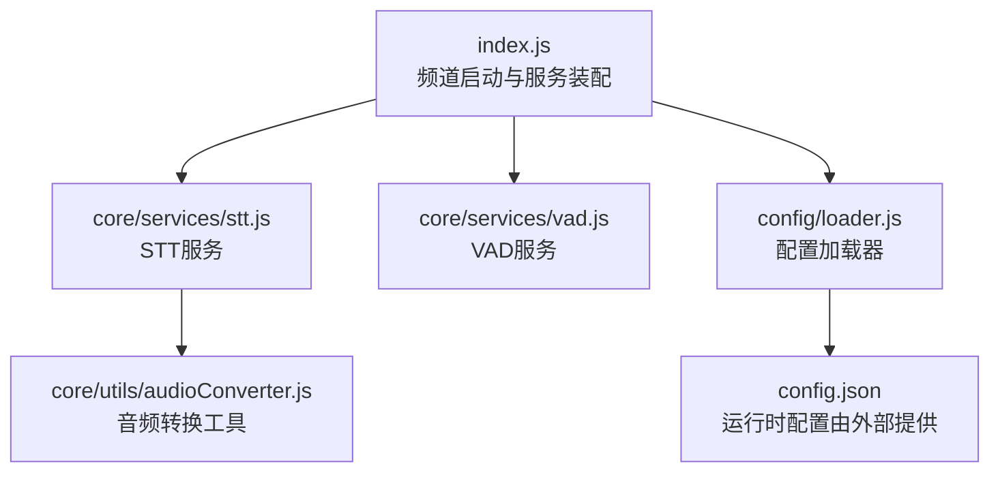
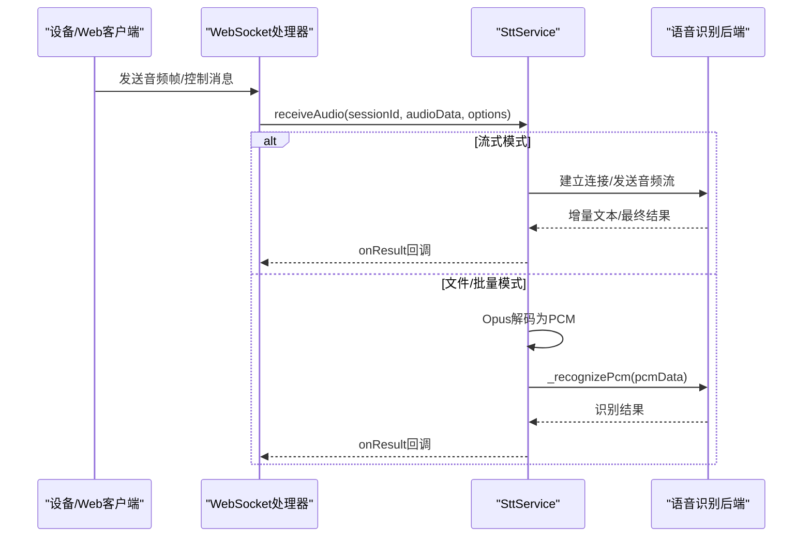
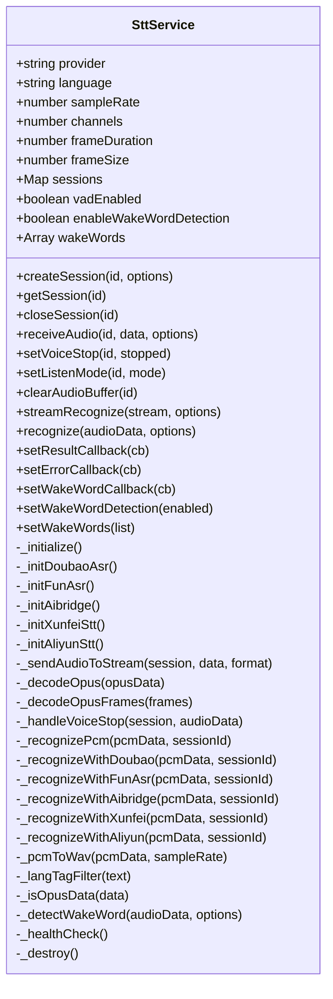
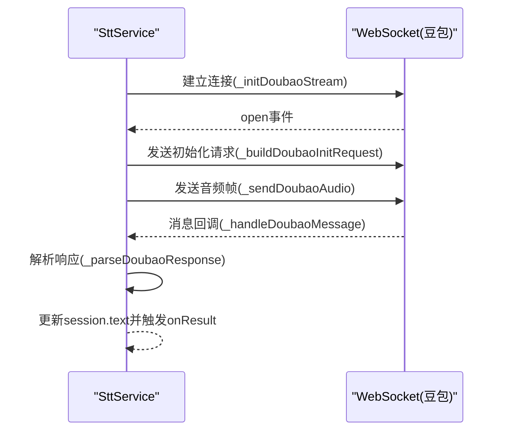
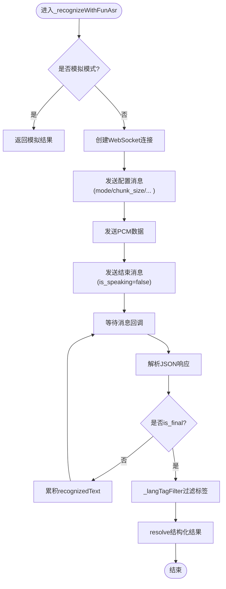
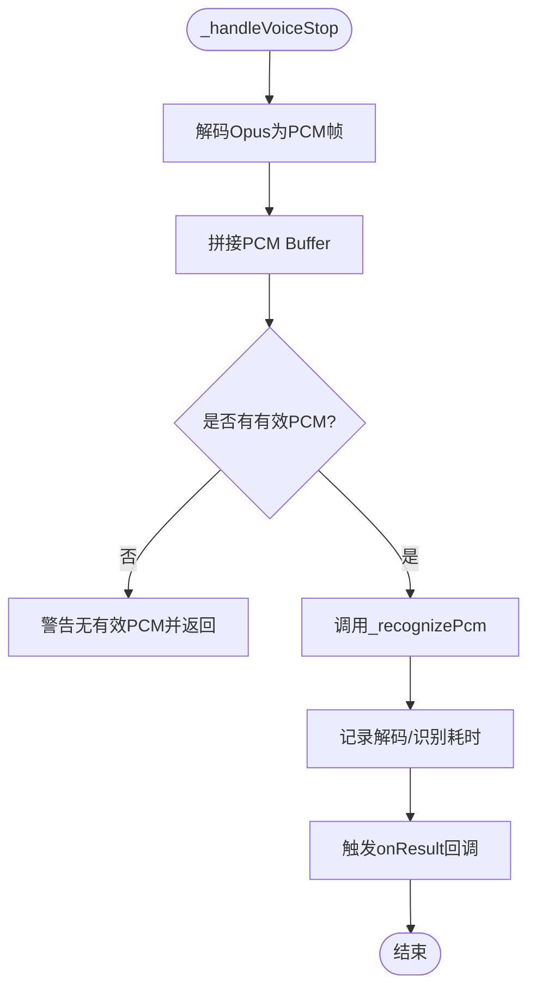
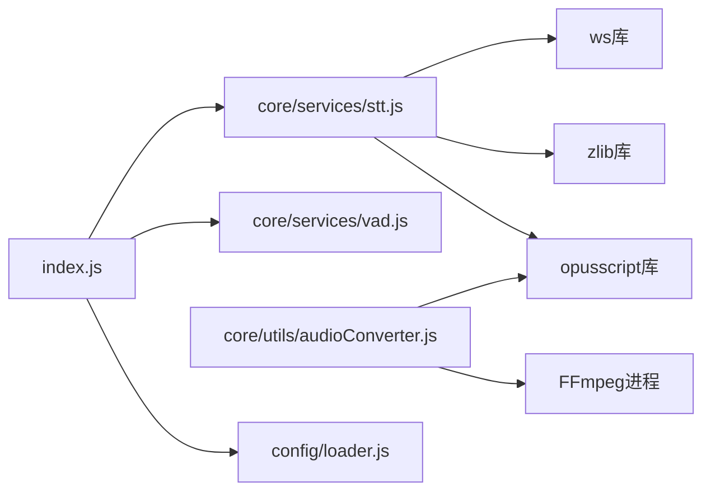

# STT语音识别服务

<cite>
**本文引用的文件**   
- [core/services/stt.js](file://core/services/stt.js)
- [core/services/vad.js](file://core/services/vad.js)
- [core/utils/audioConverter.js](file://core/utils/audioConverter.js)
- [config/loader.js](file://config/loader.js)
- [config/constants.js](file://config/constants.js)
- [index.js](file://index.js)
</cite>

## 目录
1. [简介](#简介)
2. [项目结构](#项目结构)
3. [核心组件](#核心组件)
4. [架构总览](#架构总览)
5. [详细组件分析](#详细组件分析)
6. [依赖关系分析](#依赖关系分析)
7. [性能与资源特性](#性能与资源特性)
8. [配置与参数说明](#配置与参数说明)
9. [故障排除指南](#故障排除指南)
10. [结论](#结论)

## 简介
本文件面向STT（语音转文字）服务的实现与使用，覆盖以下目标：
- 多提供商支持：豆包、FunASR、aibridge桥接、讯飞、阿里云Qwen-ASR。
- 两种识别模式：流式识别与文件/批量识别。
- 音频处理：Opus解码、PCM格式转换、WAV封装、FFmpeg管道。
- 会话管理：会话生命周期、缓冲区控制、监听模式与语音停止检测。
- VAD集成：VAD服务接口与默认行为。
- 唤醒词检测：开关、回调与简化实现。
- 性能监控：关键路径耗时统计与日志。
- 错误处理：连接探活、超时、异常捕获与回退模拟模式。
- 配置示例与环境变量映射。

## 项目结构
STT相关代码主要分布在以下位置：
- 核心服务：`core/services/stt.js`
- VAD服务：`core/services/vad.js`
- 音频工具：`core/utils/audioConverter.js`
- 配置加载：`config/loader.js`、`config/constants.js`
- 应用入口与服务装配：`index.js`

**图示来源**
- [index.js:180-216](file://index.js#L180-L216)
- [core/services/stt.js:39-121](file://core/services/stt.js#L39-L121)
- [core/services/vad.js:3-10](file://core/services/vad.js#L3-L10)
- [core/utils/audioConverter.js:11-18](file://core/utils/audioConverter.js#L11-L18)
- [config/loader.js:13-44](file://config/loader.js#L13-L44)

**章节来源**
- [index.js:180-216](file://index.js#L180-L216)
- [config/loader.js:13-44](file://config/loader.js#L13-L44)

## 核心组件
- STT服务：统一抽象多种语音识别后端，负责音频解码、会话管理、流式与文件识别、结果回调与错误处理。
- VAD服务：语音活动检测的抽象层，默认返回null以交由调用方本地逻辑处理。
- 音频转换器：基于FFmpeg与opusscript进行MP3/任意格式到Opus帧的转换，以及PCM到Opus编码。
- 配置加载器：从config.json读取并合并环境变量，暴露getSttConfig等便捷方法。

**章节来源**
- [core/services/stt.js:39-121](file://core/services/stt.js#L39-L121)
- [core/services/vad.js:3-26](file://core/services/vad.js#L3-L26)
- [core/utils/audioConverter.js:11-18](file://core/utils/audioConverter.js#L11-L18)
- [config/loader.js:98-139](file://config/loader.js#L98-L139)

## 架构总览
STT服务在应用启动时由XiaozhiChannel初始化，随后通过WebSocket处理器接入设备消息流。STT内部根据provider分发到不同后端；同时维护会话Map，按流式或文件模式处理音频数据。

**图示来源**
- [core/services/stt.js:348-383](file://core/services/stt.js#L348-L383)
- [core/services/stt.js:591-606](file://core/services/stt.js#L591-L606)
- [core/services/stt.js:846-959](file://core/services/stt.js#L846-L959)

## 详细组件分析

### STT服务类（SttService）
职责与关键点：
- 初始化：根据provider选择具体后端初始化逻辑，包括豆包、FunASR、aibridge、讯飞、阿里云。
- 会话管理：createSession/getSession/closeSession，维护audioBuffer、ws连接、listenMode、voiceStop等状态。
- 音频处理：_decodeOpus/_decodeOpusFrames将Opus帧解码为PCM；_pcmToWav用于部分后端需要的WAV封装。
- 识别流程：receiveAudio聚合音频，自动模式下在语音停止时触发_handleVoiceStop，再调用_recognizePcm分发到各后端。
- 结果回调：onResult/onError供上层订阅。
- 健康检查与销毁：_healthCheck/_destroy清理资源。

**图示来源**
- [core/services/stt.js:39-121](file://core/services/stt.js#L39-L121)
- [core/services/stt.js:293-340](file://core/services/stt.js#L293-L340)
- [core/services/stt.js:348-383](file://core/services/stt.js#L348-L383)
- [core/services/stt.js:419-508](file://core/services/stt.js#L419-L508)
- [core/services/stt.js:515-583](file://core/services/stt.js#L515-L583)
- [core/services/stt.js:591-606](file://core/services/stt.js#L591-L606)
- [core/services/stt.js:611-840](file://core/services/stt.js#L611-L840)
- [core/services/stt.js:846-1010](file://core/services/stt.js#L846-L1010)
- [core/services/stt.js:1016-1103](file://core/services/stt.js#L1016-L1103)
- [core/services/stt.js:1108-1185](file://core/services/stt.js#L1108-L1185)
- [core/services/stt.js:1193-1288](file://core/services/stt.js#L1193-L1288)
- [core/services/stt.js:1378-1439](file://core/services/stt.js#L1378-L1439)

#### 流式识别流程（豆包为例）

**图示来源**
- [core/services/stt.js:642-677](file://core/services/stt.js#L642-L677)
- [core/services/stt.js:694-731](file://core/services/stt.js#L694-L731)
- [core/services/stt.js:749-773](file://core/services/stt.js#L749-L773)
- [core/services/stt.js:778-840](file://core/services/stt.js#L778-L840)

#### 文件/批量识别流程（FunASR为例）

**图示来源**
- [core/services/stt.js:846-959](file://core/services/stt.js#L846-L959)
- [core/services/stt.js:966-1010](file://core/services/stt.js#L966-L1010)

#### 语音停止处理与性能统计

**图示来源**
- [core/services/stt.js:515-583](file://core/services/stt.js#L515-L583)

### VAD服务（VadService）
- 默认实现仅打印初始化日志，并提供一个空实现的detect方法，返回null表示未启用具体引擎，交由调用方使用本地VAD逻辑。
- 该设计便于扩展第三方VAD引擎或保持轻量默认行为。

**章节来源**
- [core/services/vad.js:3-26](file://core/services/vad.js#L3-L26)

### 音频转换工具（AudioConverter）
- 使用FFmpeg子进程将输入音频（如MP3）转换为16kHz单声道PCM，然后使用opusscript编码器生成Opus帧。
- 提供mp3ToOpusFrames、convertToOpusFrames、encodePcmToOpus等方法，支持自定义采样率、声道数与帧时长。
- 对最后一帧不足的情况进行静音补齐，保证每帧大小一致。

**章节来源**
- [core/utils/audioConverter.js:11-18](file://core/utils/audioConverter.js#L11-L18)
- [core/utils/audioConverter.js:25-106](file://core/utils/audioConverter.js#L25-L106)
- [core/utils/audioConverter.js:114-194](file://core/utils/audioConverter.js#L114-L194)
- [core/utils/audioConverter.js:201-228](file://core/utils/audioConverter.js#L201-L228)

### 配置加载器（ConfigLoader）
- 从config.json加载配置，并通过环境变量覆盖STT/TTS/服务器等配置项。
- 提供getSttConfig、getFunasrConfig等便捷方法，便于其他模块获取配置。
- 校验配置完整性，缺失必要字段会抛出错误。

**章节来源**
- [config/loader.js:13-44](file://config/loader.js#L13-L44)
- [config/loader.js:49-74](file://config/loader.js#L49-L74)
- [config/loader.js:98-139](file://config/loader.js#L98-L139)
- [config/loader.js:171-201](file://config/loader.js#L171-L201)

## 依赖关系分析
- index.js在启动时实例化SttService和VadService，并将它们注入到WebSocket处理器中。
- SttService依赖opusscript进行Opus解码，依赖ws进行WebSocket通信，依赖zlib进行GZIP压缩（豆包协议）。
- AudioConverter依赖FFmpeg与opusscript进行音频格式转换与编码。
- ConfigLoader被constants与index等多处引用，集中管理配置。

**图示来源**
- [index.js:180-216](file://index.js#L180-L216)
- [core/services/stt.js:1-6](file://core/services/stt.js#L1-L6)
- [core/utils/audioConverter.js:1-4](file://core/utils/audioConverter.js#L1-L4)
- [config/loader.js:1-8](file://config/loader.js#L1-L8)

**章节来源**
- [index.js:180-216](file://index.js#L180-L216)
- [core/services/stt.js:1-6](file://core/services/stt.js#L1-L6)
- [core/utils/audioConverter.js:1-4](file://core/utils/audioConverter.js#L1-L4)
- [config/loader.js:1-8](file://config/loader.js#L1-L8)

## 性能与资源特性
- Opus解码：按frameSize（默认16kHz×60ms=960样本）解码，避免buffer detach问题导致的单帧丢失影响整体识别。
- 流式传输：仅在流式模式且WebSocket打开时发送音频，减少无效网络开销。
- 缓冲区限制：会话级audioBuffer长度受maxBufferSize限制，防止内存增长。
- 性能统计：语音停止处理路径记录解码与识别耗时，便于定位瓶颈。
- FunASR连通性探测：启动时尝试建立WebSocket连接，失败则抛出错误或跳过校验（可通过环境变量控制）。

**章节来源**
- [core/services/stt.js:419-477](file://core/services/stt.js#L419-L477)
- [core/services/stt.js:348-383](file://core/services/stt.js#L348-L383)
- [core/services/stt.js:515-583](file://core/services/stt.js#L515-L583)
- [core/services/stt.js:185-201](file://core/services/stt.js#L185-L201)

## 配置与参数说明

### STT通用配置
- provider：语音识别提供商，可选值包括 doubao、funasr、aibridge、xunfei、aliyun。
- language：识别语言，例如 zh-CN。
- sampleRate：采样率，默认16000。
- channels：声道数，默认1。
- frameDuration：帧时长(ms)，默认60。
- maxBufferSize：会话音频缓冲帧数上限，默认100。
- vadEnabled：是否启用VAD，默认true。
- vadThreshold：VAD阈值，默认0.5。
- enableWakeWordDetection：是否启用唤醒词检测，默认false。
- wakeWords：唤醒词列表，默认['小智', '你好小智']。
- outputDir：输出目录，默认'tmp/'。
- deleteAudioFile：是否删除临时音频文件，默认true。

**章节来源**
- [core/services/stt.js:40-87](file://core/services/stt.js#L40-L87)
- [config/loader.js:98-109](file://config/loader.js#L98-L109)

### 各提供商配置与认证方式

- 豆包（doubao）
  - 必要配置：appid、access_token（或accessToken）、cluster。
  - WebSocket地址：wsUrl，默认wss://openspeech.bytedance.com/api/v3/sauc/bigmodel。
  - 认证头：X-Api-App-Key、X-Api-Access-Key、X-Api-Resource-Id、X-Api-Connect-Id。
  - 音频格式：format/codec/rate/bits/channel。
  - 工作流：workflow，默认包含resample、vad、fe、decode、itn、nlu_punctuate。
  - 若缺少必要配置，将进入模拟模式。

  **章节来源**
  - [core/services/stt.js:123-153](file://core/services/stt.js#L123-L153)
  - [core/services/stt.js:682-689](file://core/services/stt.js#L682-L689)
  - [core/services/stt.js:694-731](file://core/services/stt.js#L694-L731)

- FunASR（funasr）
  - 配置项：host、port、is_ssl、api_key、mode、chunk_size、chunk_interval、itn、language。
  - 连通性探测：启动时尝试建立WebSocket连接，不可达则抛错或跳过（FUNASR_SKIP_STARTUP_CHECK=true）。
  - 识别流程：发送配置消息、PCM数据、结束消息，接收is_final结果。

  **章节来源**
  - [core/services/stt.js:155-201](file://core/services/stt.js#L155-L201)
  - [core/services/stt.js:208-241](file://core/services/stt.js#L208-L241)
  - [core/services/stt.js:846-959](file://core/services/stt.js#L846-L959)

- aibridge桥接（aibridge）
  - 配置项：baseUrl、apiKey、providerId、timeoutMs。
  - 启动强校验：调用/whoami探活，不可达则抛错。
  - 识别流程：PCM→WAV→base64 Data URL，POST /api/bridge/stt。

  **章节来源**
  - [core/services/stt.js:1016-1039](file://core/services/stt.js#L1016-L1039)
  - [core/services/stt.js:1044-1103](file://core/services/stt.js#L1044-L1103)

- 讯飞（xunfei）
  - 配置项：appId、apiKey、apiSecret。
  - 当前为简化实现占位，实际应对接讯飞API。

  **章节来源**
  - [core/services/stt.js:243-252](file://core/services/stt.js#L243-L252)
  - [core/services/stt.js:1108-1117](file://core/services/stt.js#L1108-L1117)

- 阿里云Qwen-ASR（aliyun）
  - 配置项：apiKey、baseUrl、model、enableItn、languageHint、timeoutMs。
  - 域名策略：支持workspaceId专属域名或通用域名。
  - 识别流程：PCM→WAV→base64 Data URL，OpenAI兼容chat/completions同步识别。

  **章节来源**
  - [core/services/stt.js:254-285](file://core/services/stt.js#L254-L285)
  - [core/services/stt.js:1122-1185](file://core/services/stt.js#L1122-L1185)

### 环境变量映射
- STT通用：STT_PROVIDER、STT_LANGUAGE。
- FunASR：FUNASR_HOST、FUNASR_PORT、FUNASR_MODE、FUNASR_SSL、FUNASR_SKIP_STARTUP_CHECK。
- 豆包：DOUBAO_ASR_APPID、DOUBAO_ASR_CLUSTER、DOUBAO_ASR_ACCESS_TOKEN。
- 阿里云：ALIBABA_DASHSCOPE_API_KEY（或ALIYUN_API_KEY）、ALIBABA_WORKSPACE_ID、ALIBABA_REGION、ALIBABA_MODEL。
- aibridge：AIBRIDGE_API_KEY。

**章节来源**
- [config/loader.js:56-73](file://config/loader.js#L56-L73)
- [core/services/stt.js:123-153](file://core/services/stt.js#L123-L153)
- [core/services/stt.js:254-285](file://core/services/stt.js#L254-L285)
- [core/services/stt.js:1016-1039](file://core/services/stt.js#L1016-L1039)

## 故障排除指南

### 常见问题与定位
- 无法加载opusscript模块
  - 现象：控制台报错提示安装opusscript。
  - 处理：执行npm install opussscript后重启服务。
  - 参考路径：[core/services/stt.js:14-25](file://core/services/stt.js#L14-L25)

- FunASR服务不可达
  - 现象：启动时报错提示FunASR不可达。
  - 处理：确认start-funasr.sh已运行且模型加载完成；或设置FUNASR_SKIP_STARTUP_CHECK=true跳过校验。
  - 参考路径：[core/services/stt.js:185-201](file://core/services/stt.js#L185-L201)

- 豆包ASR缺少必要配置
  - 现象：控制台警告将使用模拟模式。
  - 处理：补充appid与access_token（或accessToken），确保鉴权头正确。
  - 参考路径：[core/services/stt.js:144-150](file://core/services/stt.js#L144-L150)

- aibridge服务不可达
  - 现象：启动时报错提示aibridge不可达。
  - 处理：确认baseUrl与apiKey正确，/api/bridge/whoami可访问。
  - 参考路径：[core/services/stt.js:1027-1039](file://core/services/stt.js#L1027-L1039)

- 阿里云Qwen-ASR缺少apiKey
  - 现象：控制台警告将使用模拟模式。
  - 处理：设置DASHSCOPE_API_KEY或ALIYUN_API_KEY。
  - 参考路径：[core/services/stt.js:277-282](file://core/services/stt.js#L277-L282)

- Opus解码异常
  - 现象：解码警告或单帧丢失。
  - 处理：检查输入帧大小与frameSize匹配；忽略单帧错误不影响整体识别。
  - 参考路径：[core/services/stt.js:419-477](file://core/services/stt.js#L419-L477)

- FFmpeg进程错误
  - 现象：音频转换失败，stderr输出错误信息。
  - 处理：确认系统已安装FFmpeg且PATH可用；检查输入音频格式。
  - 参考路径：[core/utils/audioConverter.js:64-96](file://core/utils/audioConverter.js#L64-L96)

### 诊断建议
- 开启调试日志：关注STT与AudioConverter的debug/warn/error日志。
- 检查会话状态：通过API或日志查看sessions数量与状态。
- 验证提供商连通性：分别测试豆包WebSocket、FunASR WebSocket、aibridge HTTP、阿里云HTTP。
- 调整VAD阈值：通过API热更新minMaxAmplitude/minAvgAmplitude/silenceThresholdMs。

**章节来源**
- [core/services/stt.js:419-477](file://core/services/stt.js#L419-L477)
- [core/services/stt.js:185-201](file://core/services/stt.js#L185-L201)
- [core/services/stt.js:1027-1039](file://core/services/stt.js#L1027-L1039)
- [core/utils/audioConverter.js:64-96](file://core/utils/audioConverter.js#L64-L96)
- [index.js:298-344](file://index.js#L298-L344)

## 结论
STT服务通过统一的SttService抽象，实现了多提供商语音识别的统一接入，涵盖流式与文件两种模式，并在音频处理层面提供了Opus解码、PCM转换与WAV封装能力。配合VAD服务、唤醒词检测与会话管理，形成完整的语音交互链路。配置加载器与环境变量机制使得部署灵活可控。在生产环境中，建议优先保障FunASR/aibridge/阿里云等后端连通性，合理设置VAD阈值与缓冲区大小，结合日志与性能统计持续优化识别延迟与准确率。