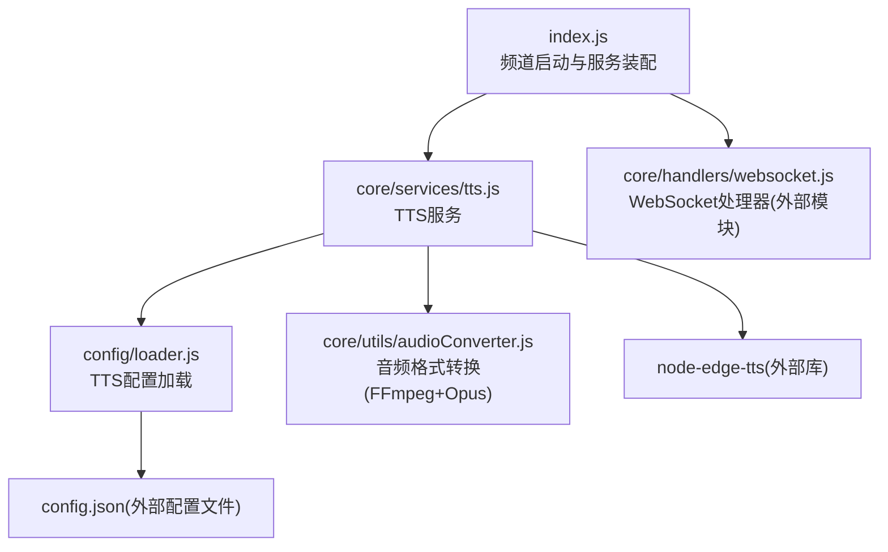
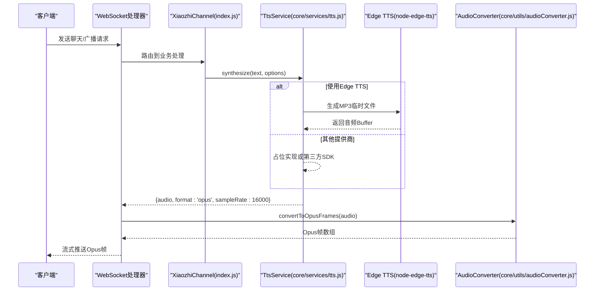
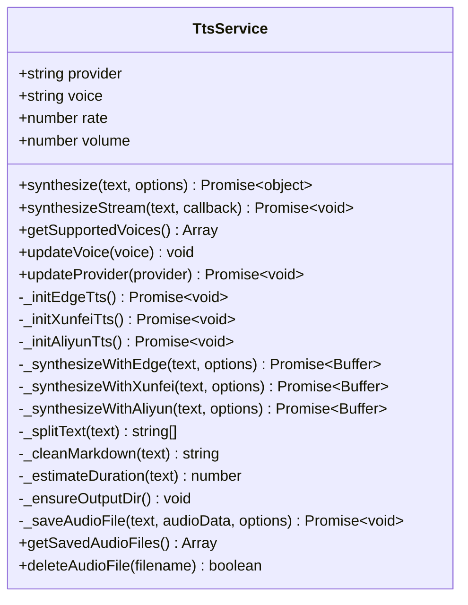
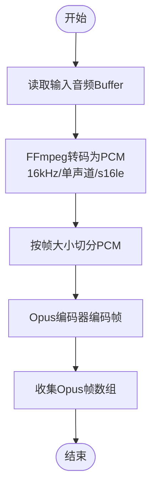
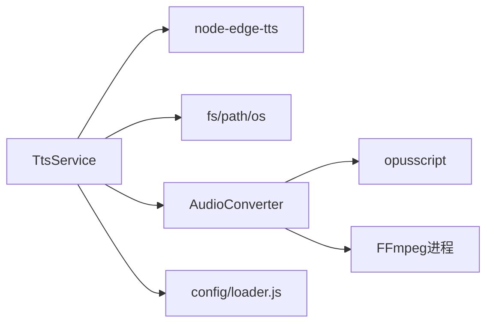

# TTS语音合成服务

<cite>
**本文引用的文件**   
- [core/services/tts.js](file://core/services/tts.js)
- [config/loader.js](file://config/loader.js)
- [config/constants.js](file://config/constants.js)
- [core/utils/audioConverter.js](file://core/utils/audioConverter.js)
- [index.js](file://index.js)
</cite>

## 目录
1. [简介](#简介)
2. [项目结构](#项目结构)
3. [核心组件](#核心组件)
4. [架构总览](#架构总览)
5. [详细组件分析](#详细组件分析)
6. [依赖关系分析](#依赖关系分析)
7. [性能与调优](#性能与调优)
8. [故障排查](#故障排查)
9. [结论](#结论)
10. [附录：配置与接口参考](#附录配置与接口参考)

## 简介
本文件面向TTS语音合成服务，系统化说明其工作流程、提供商接入、音频编码与流式播放、多语言与风格控制、缓存策略以及性能调优建议。该服务以Edge TTS为默认实现，并预留讯飞、阿里云等第三方提供商扩展点；同时提供音频格式转换（MP3/PCM到Opus）、采样率统一、音量与语速调节能力，并通过WebSocket通道将音频流式推送至客户端进行实时播放。

## 项目结构
围绕TTS相关代码的关键位置如下：
- 服务实现：core/services/tts.js
- 配置加载与默认值：config/loader.js
- 常量与枚举：config/constants.js
- 音频转换工具：core/utils/audioConverter.js
- 频道入口与服务装配：index.js

图示来源
- [index.js:180-216](file://index.js#L180-L216)
- [core/services/tts.js:1-21](file://core/services/tts.js#L1-L21)
- [config/loader.js:111-122](file://config/loader.js#L111-L122)
- [core/utils/audioConverter.js:1-18](file://core/utils/audioConverter.js#L1-L18)

章节来源
- [index.js:180-216](file://index.js#L180-L216)
- [core/services/tts.js:1-21](file://core/services/tts.js#L1-L21)
- [config/loader.js:111-122](file://config/loader.js#L111-L122)

## 核心组件
- TtsService：负责文本预处理、提供商选择、音频生成、时长估算、流式分段合成、健康检查、语音列表与保存文件管理。
- AudioConverter：基于FFmpeg与opusscript将任意输入音频转换为Opus帧，支持可配置的采样率、声道数与帧时长。
- ConfigLoader：从config.json读取TTS配置，并提供环境变量覆盖与默认值。
- Constants：定义TTS状态、音频格式等常量。
- XiaozhiChannel：在频道启动时初始化TtsService，并将实例注入WebSocket处理器。

章节来源
- [core/services/tts.js:1-438](file://core/services/tts.js#L1-L438)
- [core/utils/audioConverter.js:1-235](file://core/utils/audioConverter.js#L1-L235)
- [config/loader.js:111-122](file://config/loader.js#L111-L122)
- [config/constants.js:85-104](file://config/constants.js#L85-L104)
- [index.js:180-216](file://index.js#L180-L216)

## 架构总览
TTS服务在频道启动时被创建并初始化，随后通过WebSocket处理器被调用完成“文本→音频→流式播放”的链路。

图示来源
- [index.js:180-216](file://index.js#L180-L216)
- [core/services/tts.js:62-104](file://core/services/tts.js#L62-L104)
- [core/services/tts.js:106-147](file://core/services/tts.js#L106-L147)
- [core/utils/audioConverter.js:114-194](file://core/utils/audioConverter.js#L114-L194)

## 详细组件分析

### TtsService：文本预处理、引擎选择、音频输出与流式合成
- 文本预处理
  - 清理Markdown标记，避免特殊语法影响发音。
  - 按标点符号切分句子，便于流式分段合成。
- 引擎选择
  - 根据provider字段选择Edge、讯飞或阿里云实现。
  - 默认Edge TTS，动态导入node-edge-tts库。
- 音频输出
  - 统一对外返回format为opus、sampleRate为16000的结构体。
  - 内部Edge路径生成MP3临时文件后转为Buffer，可选保存到磁盘。
- 流式合成
  - synthesizeStream按标点分段依次合成，回调返回每段音频及首尾标记。
- 时长估算
  - 基于中文、英文、标点字符数量加权估算时长（毫秒）。
- 健康检查与语音管理
  - 健康检查执行一次合成验证服务可用性。
  - 提供支持的语音列表与运行时更新voice/provider的能力。

图示来源
- [core/services/tts.js:1-438](file://core/services/tts.js#L1-L438)

章节来源
- [core/services/tts.js:62-104](file://core/services/tts.js#L62-L104)
- [core/services/tts.js:106-147](file://core/services/tts.js#L106-L147)
- [core/services/tts.js:163-202](file://core/services/tts.js#L163-L202)
- [core/services/tts.js:209-267](file://core/services/tts.js#L209-L267)
- [core/services/tts.js:274-286](file://core/services/tts.js#L274-L286)
- [core/services/tts.js:288-322](file://core/services/tts.js#L288-L322)
- [core/services/tts.js:328-434](file://core/services/tts.js#L328-L434)

### AudioConverter：音频格式转换与Opus编码
- 功能要点
  - 通过FFmpeg将任意输入音频（如MP3）转码为16kHz单声道PCM。
  - 使用opusscript将PCM数据按帧编码为Opus帧。
  - 支持自定义采样率、声道数与帧时长。
- 关键流程
  - mp3ToOpusFrames：针对MP3输入的专用转换。
  - convertToOpusFrames：通用音频缓冲区的Opus帧转换。
  - encodePcmToOpus：直接对PCM数据进行Opus编码。

图示来源
- [core/utils/audioConverter.js:25-106](file://core/utils/audioConverter.js#L25-L106)
- [core/utils/audioConverter.js:114-194](file://core/utils/audioConverter.js#L114-L194)
- [core/utils/audioConverter.js:201-228](file://core/utils/audioConverter.js#L201-L228)

章节来源
- [core/utils/audioConverter.js:1-235](file://core/utils/audioConverter.js#L1-L235)

### 配置系统：TTS配置加载与环境变量覆盖
- 默认值
  - provider默认为edge，voice默认为zh-CN-XiaoxiaoNeural，rate/volume默认1.0。
- 环境变量覆盖
  - TTS_PROVIDER、TTS_VOICE可覆盖配置文件中的对应项。
- 校验
  - 校验tts.provider与tts.voice是否缺失。

章节来源
- [config/loader.js:49-74](file://config/loader.js#L49-L74)
- [config/loader.js:111-122](file://config/loader.js#L111-L122)
- [config/loader.js:171-201](file://config/loader.js#L171-L201)

### 常量定义：TTS状态与音频格式
- TTS_STATES：start、sentence_start、stop
- AUDIO_FORMATS：opus、pcm、mp3

章节来源
- [config/constants.js:85-104](file://config/constants.js#L85-L104)

### 频道集成：服务装配与WebSocket注入
- 在频道初始化阶段创建TtsService实例，并传入TTS配置。
- 将ttsService注入WebSocket处理器，供后续会话与广播流程调用。

章节来源
- [index.js:180-216](file://index.js#L180-L216)
- [index.js:235-282](file://index.js#L235-L282)

## 依赖关系分析
- TtsService依赖
  - node-edge-tts：Edge TTS实现（动态导入）。
  - fs/path/os：临时文件与输出目录管理。
  - opusscript与FFmpeg：由AudioConverter用于音频格式转换。
- 配置依赖
  - config/loader.js提供TTS配置与默认值。
- 运行期依赖
  - WebSocket处理器与设备端播放器消费Opus帧。

图示来源
- [core/services/tts.js:40-50](file://core/services/tts.js#L40-L50)
- [core/utils/audioConverter.js:1-4](file://core/utils/audioConverter.js#L1-L4)
- [config/loader.js:111-122](file://config/loader.js#L111-L122)

章节来源
- [core/services/tts.js:40-50](file://core/services/tts.js#L40-L50)
- [core/utils/audioConverter.js:1-4](file://core/utils/audioConverter.js#L1-L4)
- [config/loader.js:111-122](file://config/loader.js#L111-L122)

## 性能与调优
- 文本预处理优化
  - 合理设置punctuations与firstSentencePunctuations，减少无效分段，降低网络往返次数。
- 流式合成
  - 优先使用synthesizeStream，边合成边播放，降低端到端延迟。
- 音频编码
  - 统一采用16kHz单声道Opus，兼顾音质与带宽；确保FFmpeg可用且版本较新。
- 并发与资源
  - 控制并发合成任务数，避免频繁创建FFmpeg子进程导致CPU抖动。
- 缓存策略
  - 当前未内置文本级缓存；可通过上层应用对常见短句结果做本地缓存，减少重复合成。
- 日志与监控
  - 关注TTS合成耗时、音频大小、错误堆栈，结合系统负载评估是否需要扩容或降级。

[本节为通用指导，不直接分析具体文件]

## 故障排查
- Edge TTS初始化失败
  - 现象：抛出“Edge TTS初始化失败”。
  - 排查：确认node-edge-tts已安装；检查网络连通性；查看控制台错误信息。
- 不支持的提供商
  - 现象：抛出“不支持的TTS提供商”。
  - 排查：检查config.tts.provider是否为edge/xunfei/aliyun之一。
- FFmpeg不可用或转码失败
  - 现象：AudioConverter报FFmpeg进程错误或退出码非0。
  - 排查：确认系统已安装FFmpeg且在PATH中；检查输入音频格式与参数。
- 输出目录权限问题
  - 现象：无法创建或写入data/tts-output。
  - 排查：检查目录权限与磁盘空间；必要时调整outputDir路径。

章节来源
- [core/services/tts.js:40-50](file://core/services/tts.js#L40-L50)
- [core/services/tts.js:23-38](file://core/services/tts.js#L23-L38)
- [core/utils/audioConverter.js:64-100](file://core/utils/audioConverter.js#L64-L100)
- [core/utils/audioConverter.js:153-184](file://core/utils/audioConverter.js#L153-L184)
- [core/services/tts.js:328-341](file://core/services/tts.js#L328-L341)

## 结论
TTS服务以Edge TTS为核心实现，提供完整的文本预处理、流式分段合成、音频格式转换与统一的opus输出规范。通过配置系统与常量定义，服务具备良好的可扩展性与可观测性。建议在部署环境中确保FFmpeg可用，并结合业务场景启用流式合成与合理的缓存策略，以获得更低的延迟与更高的吞吐。

[本节为总结性内容，不直接分析具体文件]

## 附录：配置与接口参考

### TTS配置项（config.json / 环境变量）
- 基础配置
  - tts.provider：TTS提供商，支持edge、xunfei、aliyun
  - tts.voice：语音ID，如zh-CN-XiaoxiaoNeural
  - tts.rate：语速，默认1.0
  - tts.volume：音量，默认1.0
- 环境变量覆盖
  - TTS_PROVIDER：覆盖tts.provider
  - TTS_VOICE：覆盖tts.voice

章节来源
- [config/loader.js:49-74](file://config/loader.js#L49-L74)
- [config/loader.js:111-122](file://config/loader.js#L111-L122)

### TtsService公开API
- synthesize(text, options)
  - 作用：同步合成文本为音频Buffer，返回包含audio、format、sampleRate、duration、provider的对象。
  - 选项：voice、rate、volume等。
- synthesizeStream(text, callback)
  - 作用：流式分段合成，回调返回每段的audio、text、isFirst、isLast。
- getSupportedVoices()
  - 作用：返回支持的语音列表。
- updateVoice(voice)
  - 作用：运行时切换语音。
- updateProvider(provider)
  - 作用：运行时切换提供商并重新初始化。
- getSavedAudioFiles() / deleteAudioFile(filename)
  - 作用：管理与删除保存的音频文件。

章节来源
- [core/services/tts.js:62-104](file://core/services/tts.js#L62-L104)
- [core/services/tts.js:209-237](file://core/services/tts.js#L209-L237)
- [core/services/tts.js:304-322](file://core/services/tts.js#L304-L322)
- [core/services/tts.js:380-434](file://core/services/tts.js#L380-L434)

### 音频格式与参数
- 输出格式：opus
- 采样率：16000 Hz
- 声道：单声道
- 帧时长：60 ms（AudioConverter默认）

章节来源
- [core/services/tts.js:93-99](file://core/services/tts.js#L93-L99)
- [core/utils/audioConverter.js:12-18](file://core/utils/audioConverter.js#L12-L18)

### 支持的TTS提供商与实现现状
- edge：完整实现，使用node-edge-tts生成MP3临时文件，再转为Buffer。
- xunfei：占位实现，返回模拟音频数据。
- aliyun：占位实现，返回模拟音频数据。

章节来源
- [core/services/tts.js:23-38](file://core/services/tts.js#L23-L38)
- [core/services/tts.js:106-161](file://core/services/tts.js#L106-L161)

### 语音风格、情感与多语言
- 多语言：通过不同voice ID切换语言（如zh-CN、en-US）。
- 风格与情感：当前未暴露独立风格/情感参数；如需扩展，可在options中新增style/emotion字段并在各提供商实现中映射。

章节来源
- [core/services/tts.js:304-311](file://core/services/tts.js#L304-L311)

### 缓存机制
- 当前未内置文本级缓存；建议在上层应用对高频短句进行本地缓存，以减少重复合成与网络开销。

[本节为通用建议，不直接分析具体文件]