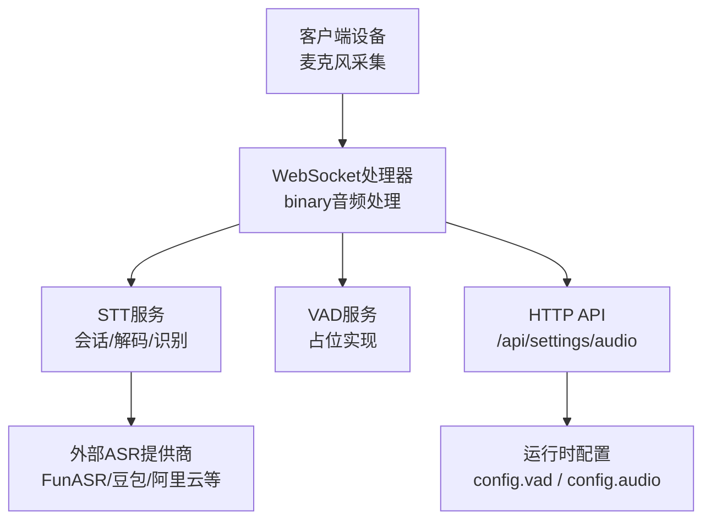
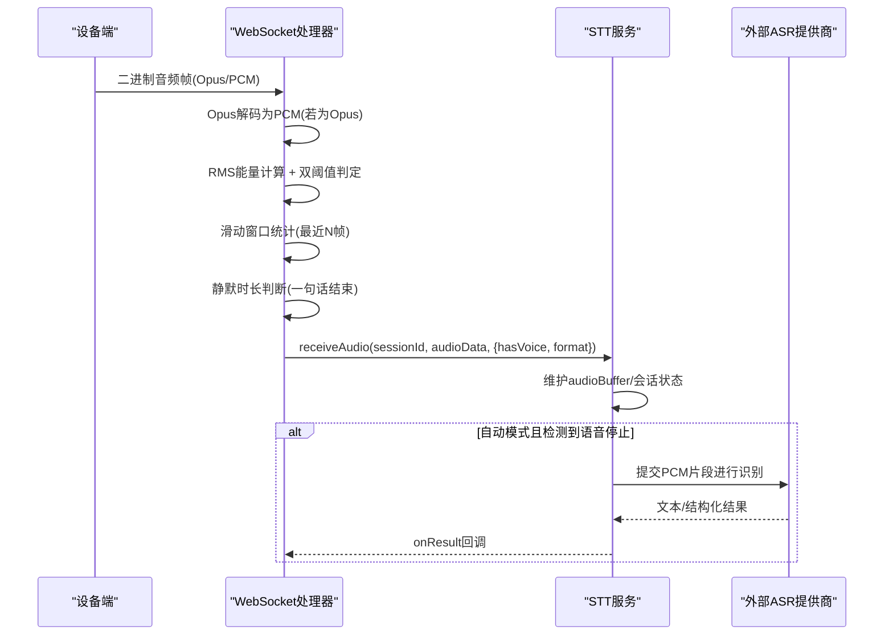
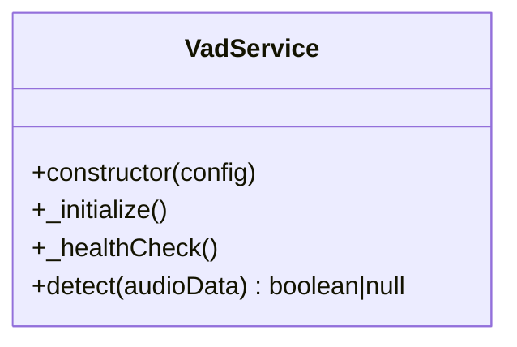
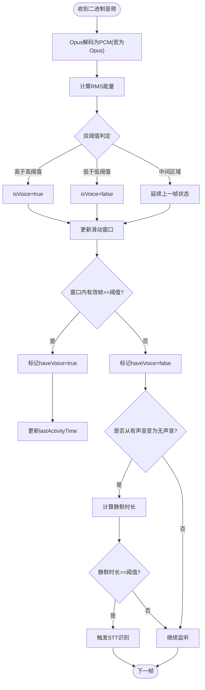
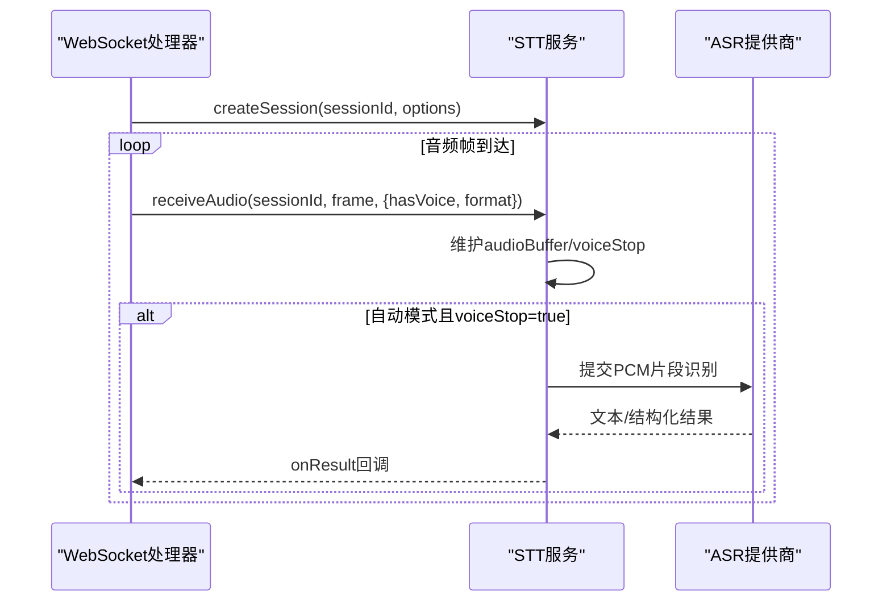
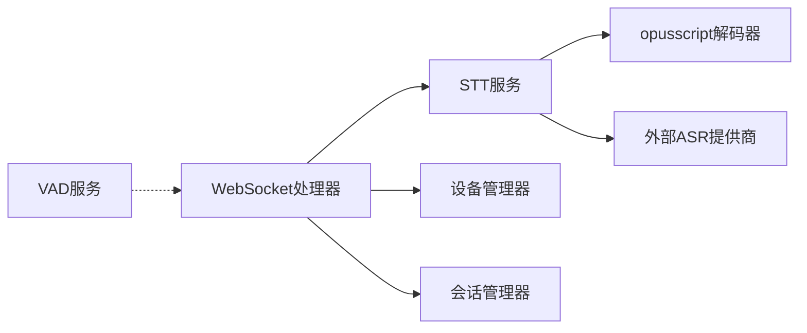
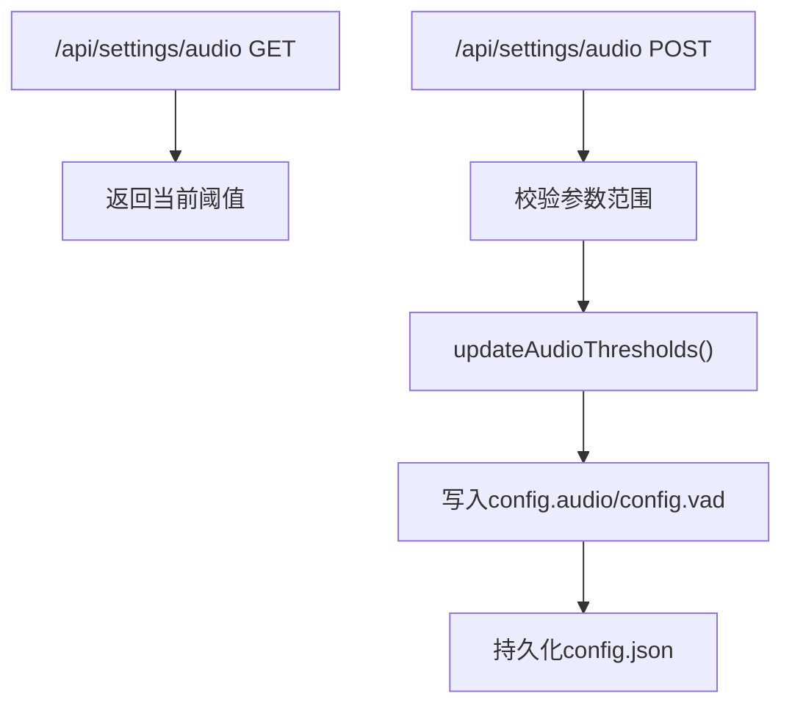
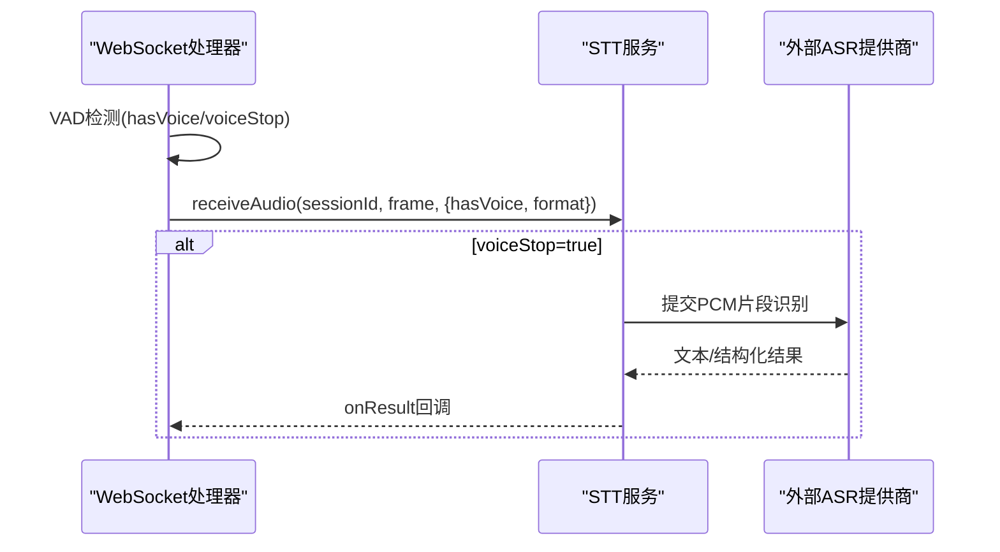

# VAD语音活动检测服务

<cite>
**本文引用的文件**   
- [vad.js](file://core/services/vad.js)
- [websocket.js](file://core/handlers/websocket.js)
- [stt.js](file://core/services/stt.js)
- [index.js](file://index.js)
- [constants.js](file://config/constants.js)
</cite>

## 目录
1. [引言](#引言)
2. [项目结构](#项目结构)
3. [核心组件](#核心组件)
4. [架构总览](#架构总览)
5. [详细组件分析](#详细组件分析)
6. [依赖关系分析](#依赖关系分析)
7. [性能与内存优化](#性能与内存优化)
8. [配置参数说明](#配置参数说明)
9. [与STT服务的集成](#与stt服务的集成)
10. [场景化配置建议](#场景化配置建议)
11. [故障排除指南](#故障排除指南)
12. [结论](#结论)

## 引言
本文件面向“VAD语音活动检测服务”，系统性说明当前代码库中的静音检测、语音起始点检测、语音结束点检测的实现原理与流程，并给出与STT（语音转文字）的集成方式、实时音频流处理与批量音频分析路径、性能优化策略、内存管理要点、并发处理细节，以及不同使用场景下的配置建议和常见问题排查方法。

需要特别说明的是：当前仓库中的 `VadService` 是一个轻量占位实现，真正的VAD逻辑主要实现在WebSocket处理器中，通过Opus解码后的PCM帧进行能量检测、双阈值状态机与滑动窗口判定，并结合静默时长触发一句话结束；同时，STT服务内部也暴露了VAD相关配置字段，用于后续扩展或与其他引擎对接。

## 项目结构
围绕VAD相关的核心文件分布如下：
- 服务层
  - `core/services/vad.js`：VAD服务抽象类（当前为默认返回未处理的占位实现）
  - `core/services/stt.js`：STT服务，包含会话管理、Opus解码、VAD相关配置字段、流式/批量识别流程
- 接入层
  - `core/handlers/websocket.js`：WebSocket消息与二进制音频处理，集中实现了VAD静音检测、语音起止判定、静默收尾、振幅有效性过滤等
- 应用入口
  - `index.js`：频道启动、服务初始化、HTTP API（含VAD相关设置接口）
- 配置常量
  - `config/constants.js`：通用常量（如消息类型、音频格式枚举等）

**图示来源**
- [websocket.js:289-446](file://core/handlers/websocket.js#L289-L446)
- [stt.js:39-87](file://core/services/stt.js#L39-L87)
- [index.js:298-344](file://index.js#L298-L344)

**章节来源**
- [vad.js:1-30](file://core/services/vad.js#L1-L30)
- [websocket.js:289-446](file://core/handlers/websocket.js#L289-L446)
- [stt.js:39-87](file://core/services/stt.js#L39-L87)
- [index.js:298-344](file://index.js#L298-L344)
- [constants.js:99-104](file://config/constants.js#L99-L104)

## 核心组件
- VadService
  - 职责：对外提供统一的VAD能力接口，当前默认实现不执行具体检测，返回null交由调用方处理。
  - 关键点：构造函数接收配置，健康检查方法返回运行状态。
- WebSocketHandler
  - 职责：负责设备连接、协议消息、二进制音频数据解析、VAD检测、STT会话联动、结果回调、打断与空闲超时等。
  - VAD相关：Opus解码→PCM→RMS能量→双阈值+滑动窗口→静默时长→语音结束→触发STT识别；同时提供振幅有效性过滤（minMaxAmplitude/minAvgAmplitude）。
- SttService
  - 职责：封装多种ASR提供商的初始化、流式/批量识别、Opus解码、会话管理、VAD相关配置字段（vadEnabled/vadThreshold）。
  - 与VAD的关系：当前VAD主逻辑在WS层，但STT侧预留了VAD开关与阈值字段，便于未来将VAD能力下沉到STT或替换为第三方VAD引擎。

**章节来源**
- [vad.js:3-26](file://core/services/vad.js#L3-L26)
- [websocket.js:22-60](file://core/handlers/websocket.js#L22-L60)
- [stt.js:39-87](file://core/services/stt.js#L39-L87)

## 架构总览
下图展示从设备端采集音频到服务端VAD检测、再到STT识别的整体数据流与控制流。

**图示来源**
- [websocket.js:289-446](file://core/handlers/websocket.js#L289-L446)
- [websocket.js:2300-2423](file://core/handlers/websocket.js#L2300-L2423)
- [stt.js:348-383](file://core/services/stt.js#L348-L383)
- [stt.js:515-583](file://core/services/stt.js#L515-L583)

## 详细组件分析

### VAD服务（VadService）
- 设计意图：作为统一的服务抽象，便于未来替换为更复杂的VAD引擎（如Silero、WebRTC VAD等）。
- 当前行为：_initialize与健康检查可用；detect默认返回null，表示“未启用具体引擎”，由上层决定如何处理。
- 扩展建议：
  - 在detect中实现基于RMS能量的快速门限判断，或与STT共享解码器以减少重复解码。
  - 支持按设备维度传入阈值，避免全局阈值对多环境设备的误判。

**图示来源**
- [vad.js:3-26](file://core/services/vad.js#L3-L26)

**章节来源**
- [vad.js:1-30](file://core/services/vad.js#L1-L30)

### WebSocket处理器中的VAD逻辑
- 输入：二进制音频帧（优先Opus），经STT服务提供的Opus解码器解码为PCM。
- 能量检测：对每帧PCM计算RMS能量，归一化后与高/低双阈值比较，得到isVoice；中间区域保持上一帧状态，避免抖动。
- 滑动窗口：维护最近若干帧的isVoice序列，超过阈值数量即认为“有声音”。
- 语音起始点：当窗口内有效帧数达到阈值时，标记haveVoice=true，更新lastActivityTime。
- 语音结束点：当从“有声音”转为“无声音”，且静默时长超过SILENCE_THRESHOLD_MS，则voiceStop=true，触发STT识别。
- 兜底机制：连续有声超过maxUtteranceMs强制触发一次识别，防止底噪偏高导致永远无法结束。
- 振幅有效性：在发送前对PCM做振幅有效性过滤（minMaxAmplitude/minAvgAmplitude），降低纯噪音进入识别的概率。

**图示来源**
- [websocket.js:2300-2423](file://core/handlers/websocket.js#L2300-L2423)
- [websocket.js:2518-2554](file://core/handlers/websocket.js#L2518-L2554)

**章节来源**
- [websocket.js:289-446](file://core/handlers/websocket.js#L289-L446)
- [websocket.js:2300-2423](file://core/handlers/websocket.js#L2300-L2423)
- [websocket.js:2518-2554](file://core/handlers/websocket.js#L2518-L2554)

### STT服务中的VAD相关配置与流程
- 配置字段：
  - vadEnabled：是否启用VAD（默认true）
  - vadThreshold：VAD阈值（默认0.5）
- 会话与会话状态：
  - createSession/closeSession管理会话生命周期
  - receiveAudio累积音频缓冲，并在自动模式下根据voiceStop触发识别
- 流式识别：
  - 建立与外部ASR提供商的WebSocket连接，持续发送音频帧
  - 解析提供商返回的结构化结果或纯文本
- 批量识别：
  - _handleVoiceStop聚合PCM片段，调用对应提供商的识别接口

**图示来源**
- [stt.js:293-311](file://core/services/stt.js#L293-L311)
- [stt.js:348-383](file://core/services/stt.js#L348-L383)
- [stt.js:515-583](file://core/services/stt.js#L515-L583)

**章节来源**
- [stt.js:39-87](file://core/services/stt.js#L39-L87)
- [stt.js:293-311](file://core/services/stt.js#L293-L311)
- [stt.js:348-383](file://core/services/stt.js#L348-L383)
- [stt.js:515-583](file://core/services/stt.js#L515-L583)

## 依赖关系分析
- WebSocket处理器依赖：
  - STT服务：用于Opus解码、会话管理与识别回调
  - 设备管理器/会话管理器：用于设备注册与会话创建
  - LLM/TTS/MCP等服务：用于完整对话链路（非VAD核心）
- STT服务依赖：
  - 外部ASR提供商：通过WebSocket或HTTP接口进行识别
  - opusscript模块：延迟加载，按需初始化解码器
- VAD服务依赖：
  - 当前为空依赖，仅继承基础服务类

**图示来源**
- [websocket.js:22-60](file://core/handlers/websocket.js#L22-L60)
- [stt.js:8-25](file://core/services/stt.js#L8-L25)
- [vad.js:1-6](file://core/services/vad.js#L1-L6)

**章节来源**
- [websocket.js:22-60](file://core/handlers/websocket.js#L22-L60)
- [stt.js:8-25](file://core/services/stt.js#L8-L25)
- [vad.js:1-6](file://core/services/vad.js#L1-L6)

## 性能与内存优化
- 解码优化
  - Opus解码器延迟加载，仅在首次使用时初始化，减少冷启动开销。
  - 单帧解码失败不影响整体识别，记录警告日志并跳过该帧。
- 缓冲区管理
  - STT会话维护audioBuffer，限制最大长度，避免无限增长。
  - 空帧触发识别前校验缓冲帧数，不足则丢弃，减少无效识别。
- 能量计算采样
  - 振幅有效性分析采用步进采样，降低逐样本遍历的计算量。
- 并发与串行化
  - 对话轮次串行化处理，避免同一连接多条应答音频交错。
  - 轮次超时保护，防止单轮挂死阻塞后续请求。
- 资源释放
  - 会话关闭时清理WebSocket连接与解码器引用，避免内存泄漏。

**章节来源**
- [stt.js:8-25](file://core/services/stt.js#L8-L25)
- [stt.js:348-383](file://core/services/stt.js#L348-L383)
- [websocket.js:677-693](file://core/handlers/websocket.js#L677-L693)
- [websocket.js:2518-2554](file://core/handlers/websocket.js#L2518-L2554)

## 配置参数说明
- VAD相关（WebSocket层）
  - config.vad.threshold：高阈值，用于RMS能量判定（默认0.0025）
  - config.vad.thresholdLow：低阈值，用于RMS能量判定（默认0.0015）
  - config.vad.silenceThresholdMs：静默时长阈值，触发一句话结束（默认1500ms）
  - config.vad.maxUtteranceMs：最长语音兜底时长，强制触发识别（默认8000ms）
- 振幅有效性（WebSocket层）
  - config.audio.minMaxAmplitude：最大振幅阈值（默认500）
  - config.audio.minAvgAmplitude：平均振幅阈值（默认50）
- STT相关（STT服务）
  - stt.vadEnabled：是否启用VAD（默认true）
  - stt.vadThreshold：VAD阈值（默认0.5）
- HTTP API（热更新）
  - GET/POST /api/settings/audio：读取与热更新上述阈值，并持久化至config.json

**图示来源**
- [index.js:298-344](file://index.js#L298-L344)
- [websocket.js:2476-2494](file://core/handlers/websocket.js#L2476-L2494)

**章节来源**
- [websocket.js:2300-2423](file://core/handlers/websocket.js#L2300-L2423)
- [websocket.js:2476-2494](file://core/handlers/websocket.js#L2476-L2494)
- [index.js:298-344](file://index.js#L298-L344)
- [stt.js:64-67](file://core/services/stt.js#L64-L67)

## 与STT服务的集成
- 实时音频流处理
  - WebSocket处理器在收到二进制音频后，先进行VAD检测，再将音频帧传递给STT服务receiveAudio。
  - STT服务维护会话与缓冲区，在自动模式下根据voiceStop触发识别。
  - 对于流式提供商（如豆包），STT服务会建立WebSocket连接并持续发送音频帧。
- 批量音频分析
  - 当检测到语音停止（静默时长达标）或手动停止（LISTEN.STOP）时，STT服务聚合PCM片段，调用对应提供商的识别接口。
- 结果回调
  - STT服务通过onResult回调将识别结果回传给WebSocket处理器，进一步进入LLM/TTS对话链路。

**图示来源**
- [websocket.js:289-446](file://core/handlers/websocket.js#L289-L446)
- [stt.js:348-383](file://core/services/stt.js#L348-L383)
- [stt.js:515-583](file://core/services/stt.js#L515-L583)

**章节来源**
- [websocket.js:289-446](file://core/handlers/websocket.js#L289-L446)
- [stt.js:348-383](file://core/services/stt.js#L348-L383)
- [stt.js:515-583](file://core/services/stt.js#L515-L583)

## 场景化配置建议
- 安静室内环境
  - 建议：提高threshold与thresholdLow，降低误触发；适当缩短silenceThresholdMs以提升响应速度。
  - 参考：threshold≈0.003，thresholdLow≈0.002，silenceThresholdMs≈1200~1500。
- 嘈杂办公环境
  - 建议：提高minMaxAmplitude与minAvgAmplitude以过滤底噪；延长silenceThresholdMs避免短句被切分。
  - 参考：minMaxAmplitude≈800~1200，minAvgAmplitude≈80~120，silenceThresholdMs≈1500~2000。
- 移动户外环境
  - 建议：放宽thresholdLow以避免风噪误判；增加maxUtteranceMs兜底时长，确保长句可正常结束。
  - 参考：thresholdLow≈0.001，maxUtteranceMs≈10000~12000。
- 硬件设备（无AEC）
  - 建议：加强回声过滤（已在WS层实现回声判定），必要时提高振幅阈值；避免立即打断播放声导致的自杀式中断。
  - 参考：结合_isEchoOfSpoken与_handleAbort逻辑，合理设置listenMode为manual或auto。

[本节为概念性指导，不直接分析具体文件]

## 故障排除指南
- 无法检测到语音
  - 检查config.vad.threshold与thresholdLow是否过高；查看RMS能量日志（mic diag）确认能量值是否在阈值区间。
  - 确认Opus解码是否正常，解码失败会返回空PCM导致能量为0。
- 频繁误触发识别
  - 提高minMaxAmplitude与minAvgAmplitude，过滤纯噪音；调整silenceThresholdMs避免短停顿触发。
- 一句话过长无法结束
  - 检查maxUtteranceMs是否过短；适当延长以允许更长语音自然结束。
- 识别结果不稳定
  - 检查STT提供商连通性与鉴权配置；查看模拟模式是否被启用（缺少必要配置时会降级为模拟模式）。
- 热更新阈值不生效
  - 确认通过/api/settings/audio POST正确传参；检查config.json是否成功持久化；注意设备专属阈值会覆盖服务器默认阈值。

**章节来源**
- [websocket.js:2300-2423](file://core/handlers/websocket.js#L2300-L2423)
- [websocket.js:2518-2554](file://core/handlers/websocket.js#L2518-L2554)
- [stt.js:123-153](file://core/services/stt.js#L123-L153)
- [index.js:298-344](file://index.js#L298-L344)

## 结论
当前仓库的VAD能力主要由WebSocket处理器实现，采用Opus解码+RMS能量+双阈值+滑动窗口+静默时长的组合策略，兼顾实时性与鲁棒性；STT服务提供会话管理与识别流程，并预留VAD相关配置以便未来扩展。通过HTTP API可对阈值进行热更新与持久化，满足不同环境与设备的差异化需求。建议在部署时根据实际声学环境调优阈值，并结合回声过滤与轮次串行化机制提升整体体验与稳定性。

[本节为总结性内容，不直接分析具体文件]