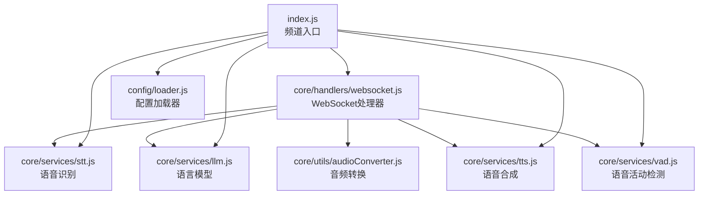
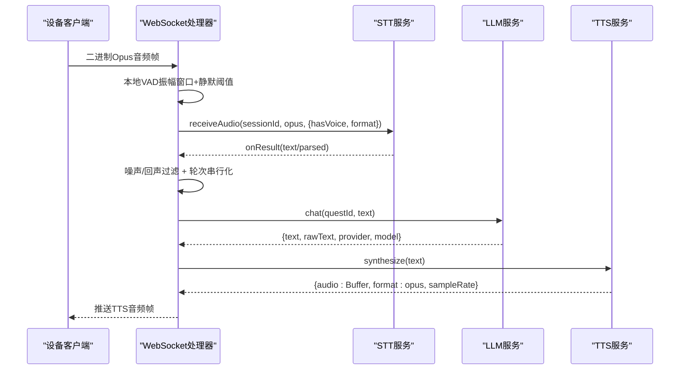
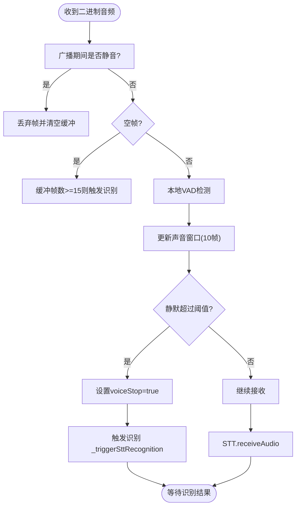
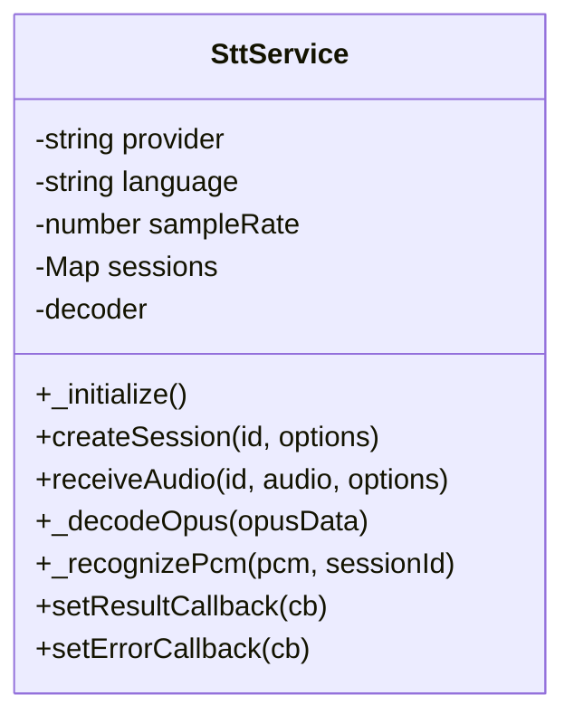
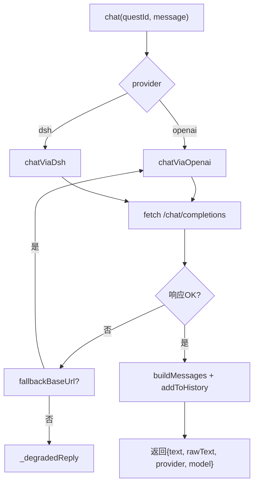
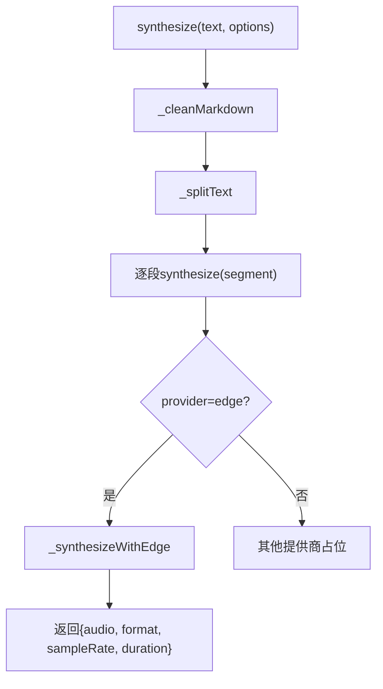
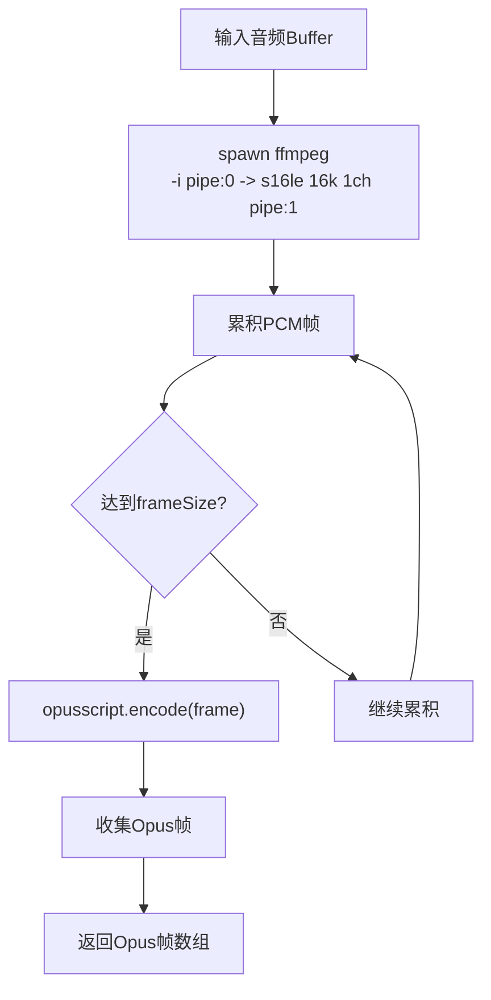
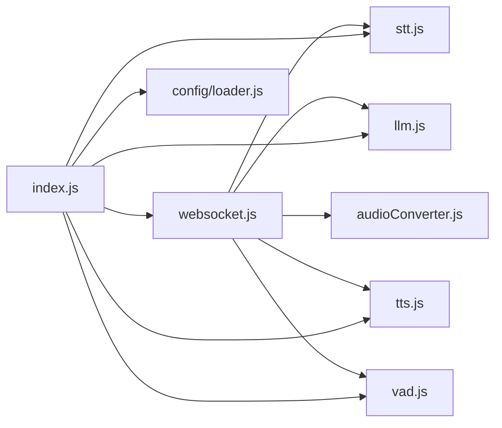

# 语音处理流水线

<cite>
**本文引用的文件**   
- [index.js](file://index.js)
- [package.json](file://package.json)
- [core/handlers/websocket.js](file://core/handlers/websocket.js)
- [core/services/stt.js](file://core/services/stt.js)
- [core/services/llm.js](file://core/services/llm.js)
- [core/services/tts.js](file://core/services/tts.js)
- [core/services/vad.js](file://core/services/vad.js)
- [core/utils/audioConverter.js](file://core/utils/audioConverter.js)
- [config/loader.js](file://config/loader.js)
</cite>

## 目录
1. [引言](#引言)
2. [项目结构](#项目结构)
3. [核心组件](#核心组件)
4. [架构总览](#架构总览)
5. [详细组件分析](#详细组件分析)
6. [依赖关系分析](#依赖关系分析)
7. [性能与调优](#性能与调优)
8. [故障排除指南](#故障排除指南)
9. [结论](#结论)
10. [附录：配置项速查](#附录配置项速查)

## 引言
本文件面向“从语音输入到AI回复”的完整语音处理流水线，覆盖以下关键环节：
- STT（语音转文字）：支持多提供商、Opus解码、流式识别、唤醒词检测。
- LLM（语言模型）：OpenAI兼容端点直连或DSH桥接，带对话历史与降级策略。
- TTS（文字转语音）：Edge TTS为主，支持分段合成与音频时长估算。
- VAD（语音活动检测）：基于振幅窗口与静默阈值的本地VAD逻辑。
- 音频格式转换与编解码：PCM/Opus互转、FFmpeg管道、帧对齐与静音补齐。
- 流式处理与会话管理：WebSocket消息路由、轮次串行化、打断与回声抑制。

该文档既提供高层架构图，也给出代码级流程图和类图，帮助不同技术背景的读者理解实现细节、配置选项与优化策略。

## 项目结构
本项目采用“服务+处理器+工具”的分层组织方式：
- 入口与频道：index.js 负责启动Express/HTTP服务器、注册WebSocket、初始化各服务并暴露REST API。
- WebSocket处理器：core/handlers/websocket.js 负责设备连接、协议解析、音频流处理、会话与轮次调度。
- 核心服务：STT、LLM、TTS、VAD分别位于 core/services 下，遵循 BaseService 抽象。
- 音频工具：core/utils/audioConverter.js 提供MP3/任意格式到Opus的转换与编码。
- 配置加载：config/loader.js 统一读取 config.json，并提供环境变量覆盖。

图表来源
- [index.js:17-27](file://index.js#L17-L27)
- [core/handlers/websocket.js:22-39](file://core/handlers/websocket.js#L22-L39)
- [core/services/stt.js:39-87](file://core/services/stt.js#L39-L87)
- [core/services/llm.js:16-24](file://core/services/llm.js#L16-L24)
- [core/services/tts.js:3-21](file://core/services/tts.js#L3-L21)
- [core/services/vad.js:3-6](file://core/services/vad.js#L3-L6)
- [core/utils/audioConverter.js:11-18](file://core/utils/audioConverter.js#L11-L18)
- [config/loader.js:13-17](file://config/loader.js#L13-L17)

章节来源
- [index.js:44-249](file://index.js#L44-L249)
- [package.json:1-29](file://package.json#L1-L29)

## 核心组件
- STT服务：封装多种语音识别后端（FunASR、豆包、aibridge、阿里云Qwen-ASR等），提供Opus解码、会话管理、流式识别与结果回调。
- LLM服务：支持OpenAI兼容端点直连与dsh桥接，维护每连接对话历史，具备超时、回退与降级回复能力。
- TTS服务：默认Edge TTS，支持文本清理、分段合成、音频时长估算与可选文件落盘。
- VAD服务：默认返回null交由调用方使用本地VAD；实际VAD逻辑在WebSocket处理器中按振幅窗口与静默阈值判定。
- 音频转换器：通过FFmpeg将任意音频转为16kHz单声道PCM，再使用opusscript编码为Opus帧，保证帧长与静音补齐。
- 配置加载器：集中读取config.json，支持端口、主机、STT/TTS/LLM等配置的环境变量覆盖。

章节来源
- [core/services/stt.js:39-121](file://core/services/stt.js#L39-L121)
- [core/services/llm.js:16-65](file://core/services/llm.js#L16-L65)
- [core/services/tts.js:3-38](file://core/services/tts.js#L3-L38)
- [core/services/vad.js:3-26](file://core/services/vad.js#L3-L26)
- [core/utils/audioConverter.js:11-18](file://core/utils/audioConverter.js#L11-L18)
- [config/loader.js:49-74](file://config/loader.js#L49-L74)

## 架构总览
下图展示一次完整的语音交互流程：设备通过WebSocket发送Opus音频帧，服务端进行VAD判断、STT识别、LLM生成回复、TTS合成并推流播放。

图表来源
- [core/handlers/websocket.js:289-446](file://core/handlers/websocket.js#L289-L446)
- [core/services/stt.js:348-383](file://core/services/stt.js#L348-L383)
- [core/services/llm.js:75-104](file://core/services/llm.js#L75-L104)
- [core/services/tts.js:62-104](file://core/services/tts.js#L62-L104)

## 详细组件分析

### WebSocket处理器：音频流与对话调度中枢
职责要点
- 接收二进制音频数据，执行本地VAD（振幅窗口、静默阈值、最长语音兜底）。
- 管理STT会话，触发识别并在收到有效文本后进入对话轮。
- 对无效输入（语气词、过短文本）与回声拾取进行过滤。
- 使用turnSeq与abortUpTo实现轮次串行化与打断控制，避免Opus帧交错。
- 调用LLM生成回复，再通过TTS合成并推流至设备。

关键流程
- 二进制音频处理：handleBinaryData → _detectVoice → STT.receiveAudio → 静默判定 → _triggerSttRecognition。
- 完整聊天处理：handleCompleteChatMessage → 噪声/回声过滤 → _runChatTurn → generateLlmResponse → sendLlmResponse → TTS合成。

图表来源
- [core/handlers/websocket.js:289-446](file://core/handlers/websocket.js#L289-L446)

章节来源
- [core/handlers/websocket.js:228-283](file://core/handlers/websocket.js#L228-L283)
- [core/handlers/websocket.js:289-446](file://core/handlers/websocket.js#L289-L446)
- [core/handlers/websocket.js:651-694](file://core/handlers/websocket.js#L651-L694)

### STT服务：多提供商语音识别与Opus解码
职责要点
- 初始化并选择提供商：funasr、doubao、aibridge、xunfei、aliyun。
- 会话管理：createSession/closeSession，维护音频缓冲区与状态。
- Opus解码：延迟加载opusscript，按frameSize正确提取有效样本。
- 流式识别：根据provider建立WebSocket或HTTP请求，发送音频并解析响应。
- 结果回调：onResult/onError供上层消费。

图表来源
- [core/services/stt.js:39-87](file://core/services/stt.js#L39-L87)
- [core/services/stt.js:293-340](file://core/services/stt.js#L293-L340)
- [core/services/stt.js:419-477](file://core/services/stt.js#L419-L477)
- [core/services/stt.js:591-606](file://core/services/stt.js#L591-L606)
- [core/services/stt.js:1348-1357](file://core/services/stt.js#L1348-L1357)

章节来源
- [core/services/stt.js:89-121](file://core/services/stt.js#L89-L121)
- [core/services/stt.js:348-383](file://core/services/stt.js#L348-L383)
- [core/services/stt.js:419-508](file://core/services/stt.js#L419-L508)
- [core/services/stt.js:591-606](file://core/services/stt.js#L591-L606)
- [core/services/stt.js:846-959](file://core/services/stt.js#L846-L959)
- [core/services/stt.js:1016-1103](file://core/services/stt.js#L1016-L1103)
- [core/services/stt.js:1122-1185](file://core/services/stt.js#L1122-L1185)

### LLM服务：对话上下文与回退策略
职责要点
- 支持openai直连与dsh桥接两种模式。
- 构建系统提示与最近N轮对话历史，限制最大历史长度。
- 超时控制、错误回退与降级回复，确保用户体验。

图表来源
- [core/services/llm.js:75-104](file://core/services/llm.js#L75-L104)
- [core/services/llm.js:121-160](file://core/services/llm.js#L121-L160)
- [core/services/llm.js:166-203](file://core/services/llm.js#L166-L203)
- [core/services/llm.js:211-252](file://core/services/llm.js#L211-L252)

章节来源
- [core/services/llm.js:16-65](file://core/services/llm.js#L16-L65)
- [core/services/llm.js:75-115](file://core/services/llm.js#L75-L115)
- [core/services/llm.js:121-203](file://core/services/llm.js#L121-L203)
- [core/services/llm.js:211-252](file://core/services/llm.js#L211-L252)

### TTS服务：文本清理、分段合成与时长估算
职责要点
- 默认Edge TTS，动态导入node-edge-tts。
- 清理Markdown、按标点分段、估算音频时长。
- 可选保存音频文件到输出目录。

图表来源
- [core/services/tts.js:62-104](file://core/services/tts.js#L62-L104)
- [core/services/tts.js:106-147](file://core/services/tts.js#L106-L147)
- [core/services/tts.js:209-267](file://core/services/tts.js#L209-L267)
- [core/services/tts.js:274-286](file://core/services/tts.js#L274-L286)
- [core/services/tts.js:163-202](file://core/services/tts.js#L163-L202)

章节来源
- [core/services/tts.js:3-38](file://core/services/tts.js#L3-L38)
- [core/services/tts.js:62-104](file://core/services/tts.js#L62-L104)
- [core/services/tts.js:106-147](file://core/services/tts.js#L106-L147)
- [core/services/tts.js:209-267](file://core/services/tts.js#L209-L267)
- [core/services/tts.js:274-286](file://core/services/tts.js#L274-L286)
- [core/services/tts.js:163-202](file://core/services/tts.js#L163-L202)

### VAD服务与本地VAD逻辑
- VadService默认detect返回null，表示由调用方决定具体实现。
- 实际VAD逻辑在WebSocket处理器中实现：基于最近10帧的振幅有效性统计，结合静默阈值与最长语音上限，判定一句话结束并触发识别。

章节来源
- [core/services/vad.js:3-26](file://core/services/vad.js#L3-L26)
- [core/handlers/websocket.js:332-446](file://core/handlers/websocket.js#L332-L446)

### 音频转换器：FFmpeg + Opus编码管线
职责要点
- 通过child_process.spawn调用ffmpeg，将任意输入音频转为16kHz单声道PCM。
- 使用opusscript编码器将PCM分帧编码为Opus帧，不足帧用静音补齐。
- 提供mp3ToOpusFrames与convertToOpusFrames通用接口。

图表来源
- [core/utils/audioConverter.js:25-106](file://core/utils/audioConverter.js#L25-L106)
- [core/utils/audioConverter.js:114-194](file://core/utils/audioConverter.js#L114-L194)
- [core/utils/audioConverter.js:201-228](file://core/utils/audioConverter.js#L201-L228)

章节来源
- [core/utils/audioConverter.js:11-18](file://core/utils/audioConverter.js#L11-L18)
- [core/utils/audioConverter.js:25-106](file://core/utils/audioConverter.js#L25-L106)
- [core/utils/audioConverter.js:114-194](file://core/utils/audioConverter.js#L114-L194)
- [core/utils/audioConverter.js:201-228](file://core/utils/audioConverter.js#L201-L228)

## 依赖关系分析
- index.js作为频道入口，实例化并初始化所有服务，创建Express/HTTP服务器与WebSocketServer，并将服务注入WebSocket处理器。
- WebSocket处理器依赖STT、LLM、TTS、VAD、音频转换器以及设备/会话管理器。
- STT依赖opusscript解码与外部服务（FunASR、豆包、aibridge、阿里云等）。
- LLM依赖外部OpenAI兼容端点或dsh桥接服务。
- TTS依赖node-edge-tts。
- 配置加载器集中管理config.json与环境变量覆盖。

图表来源
- [index.js:17-27](file://index.js#L17-L27)
- [core/handlers/websocket.js:22-39](file://core/handlers/websocket.js#L22-L39)
- [core/services/stt.js:39-87](file://core/services/stt.js#L39-L87)
- [core/services/llm.js:16-24](file://core/services/llm.js#L16-L24)
- [core/services/tts.js:3-21](file://core/services/tts.js#L3-L21)
- [core/services/vad.js:3-6](file://core/services/vad.js#L3-L6)
- [core/utils/audioConverter.js:11-18](file://core/utils/audioConverter.js#L11-L18)
- [config/loader.js:13-17](file://config/loader.js#L13-L17)

章节来源
- [index.js:44-249](file://index.js#L44-L249)
- [core/handlers/websocket.js:22-39](file://core/handlers/websocket.js#L22-L39)

## 性能与调优
- STT
  - Opus解码：按frameSize精确提取有效样本，避免多余内存拷贝；单帧解码失败不影响整体识别。
  - FunASR连通性探活：启动时校验服务可达，不可达可跳过校验但识别不可用。
  - 流式识别：根据provider选择合适的传输方式（WebSocket或HTTP），减少阻塞。
- LLM
  - 超时控制：为openai/dsh调用设置AbortSignal.timeout，防止长时间无响应。
  - 回退机制：dsh失败时可回退到openai，仍失败则返回降级回复。
  - 对话历史：限制最大历史长度，降低上下文开销。
- TTS
  - 文本分段：按标点分割，提升首字延迟。
  - 时长估算：按中文/英文/标点字符类型估算播放时长，便于前端UI同步。
- VAD
  - 振幅窗口：最近10帧中超过一半有声音即判定有声，减少误判。
  - 静默阈值：可热更新config.vad.silenceThresholdMs，默认1500ms。
  - 最长语音兜底：连续语音超过maxUtteranceMs强制触发识别，避免无限倾听。
- 音频转换
  - FFmpeg管道：边解码边编码，减少中间缓冲。
  - 帧对齐：不足帧用静音补齐，保证Opus帧稳定。

章节来源
- [core/services/stt.js:419-477](file://core/services/stt.js#L419-L477)
- [core/services/stt.js:185-201](file://core/services/stt.js#L185-L201)
- [core/services/llm.js:121-160](file://core/services/llm.js#L121-L160)
- [core/services/llm.js:166-203](file://core/services/llm.js#L166-L203)
- [core/services/llm.js:211-252](file://core/services/llm.js#L211-L252)
- [core/services/tts.js:209-267](file://core/services/tts.js#L209-L267)
- [core/services/tts.js:163-202](file://core/services/tts.js#L163-L202)
- [core/handlers/websocket.js:373-413](file://core/handlers/websocket.js#L373-L413)
- [core/utils/audioConverter.js:25-106](file://core/utils/audioConverter.js#L25-L106)

## 故障排除指南
常见问题与定位建议
- STT无法识别
  - 检查STT提供商配置与API密钥是否正确。
  - FunASR/aibridge启动强校验失败时，确认服务已启动且网络可达；必要时设置跳过校验环境变量。
  - 若使用Opus输入，确认opusscript已安装并可加载。
- LLM无回复
  - 检查openai兼容端点或dsh桥接服务是否在线。
  - 查看是否触发降级回复；确认fallbackBaseUrl配置。
- TTS合成失败
  - 确认node-edge-tts可用；检查临时文件写入权限。
  - 如需保存音频文件，确认输出目录存在且有写权限。
- VAD误判
  - 调整静默阈值与最长语音上限；观察振幅窗口日志。
  - 广播期间麦克风输入被静音，确认广播结束后恢复。
- 音频格式问题
  - 确认输入为Opus或PCM；如为MP3，需经FFmpeg转PCM再编码Opus。
  - 检查帧大小与采样率是否与STT/TTS期望一致。

章节来源
- [core/services/stt.js:185-201](file://core/services/stt.js#L185-L201)
- [core/services/stt.js:1016-1103](file://core/services/stt.js#L1016-L1103)
- [core/services/llm.js:109-115](file://core/services/llm.js#L109-L115)
- [core/services/tts.js:106-147](file://core/services/tts.js#L106-L147)
- [core/handlers/websocket.js:289-346](file://core/handlers/websocket.js#L289-L346)
- [core/utils/audioConverter.js:25-106](file://core/utils/audioConverter.js#L25-L106)

## 结论
本语音处理流水线以WebSocket为核心枢纽，串联STT、LLM、TTS与VAD四大组件，并通过音频转换器完成跨格式的编解码。系统在稳定性方面提供了多项保障：启动探活、超时控制、回退与降级、噪声与回声过滤、轮次串行化与打断控制。通过合理的配置与环境变量覆盖，可在不同部署环境下灵活调优，满足实时语音交互的低延迟与高可用性要求。

## 附录：配置项速查
- 服务器
  - port/host：可通过XIAOZHI_PORT/XIAOZHI_HOST或config.json覆盖。
- STT
  - provider/language/sampleRate/channels：默认funasr/zh-CN/16000/1。
  - funasr.host/port/mode/is_ssl/api_key/chunk_size/chunk_interval/itn：用于本地或远程FunASR。
  - aibridge.baseUrl/apiKey/providerId/timeoutMs：桥接STT。
  - aliyun.apiKey/baseUrl/model/enableItn/languageHint/timeoutMs：阿里云Qwen-ASR。
- TTS
  - provider/voice/rate/volume/outputDir/saveAudioFiles：默认edge/zh-CN-XiaoxiaoNeural/1.0/1.0。
- LLM
  - provider/baseUrl/model/timeoutMs：openai或dsh；openai需apiKey（AIBRIDGE_API_KEY）。
- VAD
  - silenceThresholdMs/maxUtteranceMs：静默阈值与最长语音上限，支持运行时热更新。

章节来源
- [config/loader.js:49-74](file://config/loader.js#L49-L74)
- [config/loader.js:98-152](file://config/loader.js#L98-L152)
- [index.js:298-344](file://index.js#L298-L344)