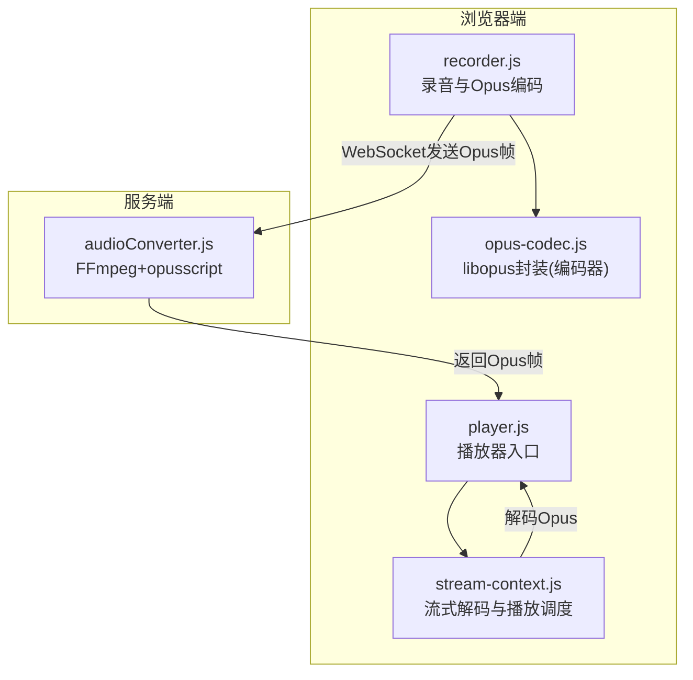
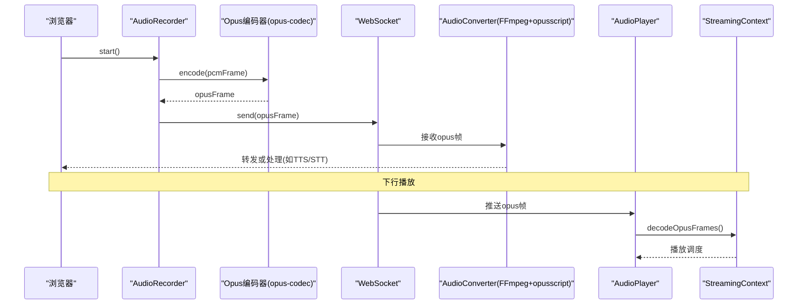
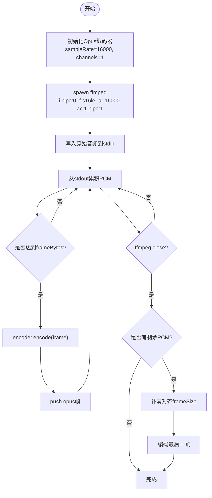
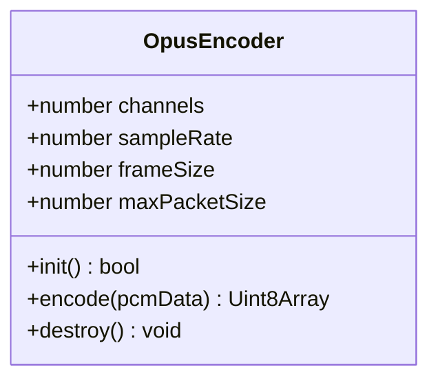
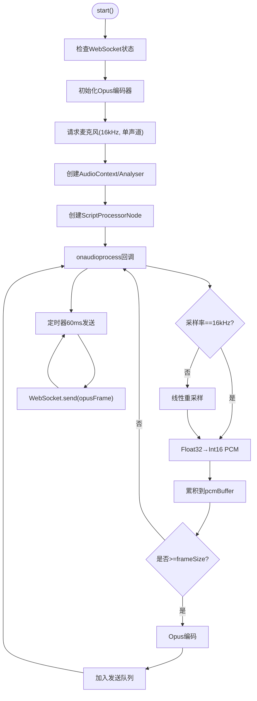
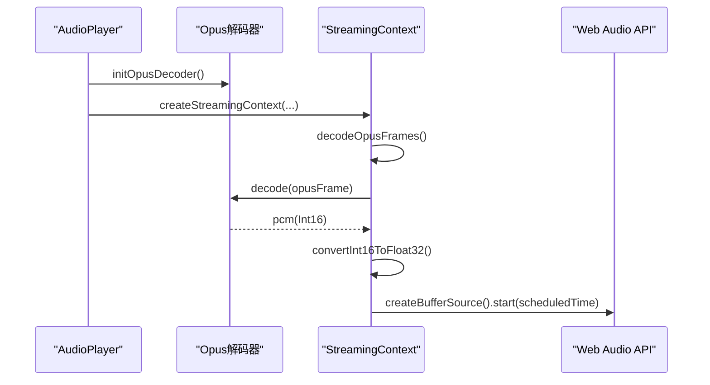
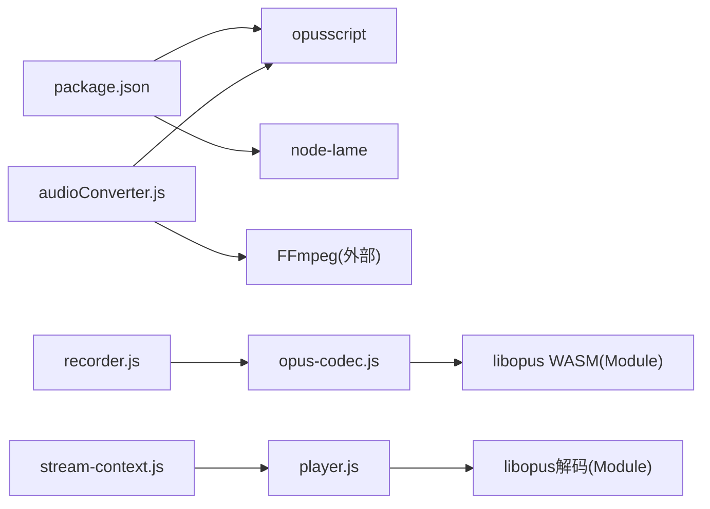

# 音频格式转换器

<cite>
**本文引用的文件**   
- [core/utils/audioConverter.js](file://core/utils/audioConverter.js)
- [public/chat/js/core/audio/opus-codec.js](file://public/chat/js/core/audio/opus-codec.js)
- [public/chat/js/core/audio/player.js](file://public/chat/js/core/audio/player.js)
- [public/chat/js/core/audio/recorder.js](file://public/chat/js/core/audio/recorder.js)
- [public/chat/js/core/audio/stream-context.js](file://public/chat/js/core/audio/stream-context.js)
- [package.json](file://package.json)
</cite>

## 目录
1. [简介](#简介)
2. [项目结构](#项目结构)
3. [核心组件](#核心组件)
4. [架构总览](#架构总览)
5. [详细组件分析](#详细组件分析)
6. [依赖关系分析](#依赖关系分析)
7. [性能与实时性](#性能与实时性)
8. [质量与压缩率优化](#质量与压缩率优化)
9. [API 使用示例与最佳实践](#api-使用示例与最佳实践)
10. [故障排查](#故障排查)
11. [结论](#结论)

## 简介
本项目实现了一个端到端的音频格式转换与流式播放系统，覆盖从浏览器端录音、编码为 Opus，到服务端将多种音频格式（MP3、WAV、PCM 等）统一转换为 Opus 帧，再到浏览器端解码并低延迟播放的完整链路。系统重点包括：
- 支持的音频格式：PCM、Opus、MP3、WAV（通过 FFmpeg 转码）。
- 采样率转换：统一至 16kHz；浏览器端对非 16kHz 输入进行重采样。
- 声道数调整：统一为单声道。
- 位深度处理：内部以 16-bit PCM 作为中间表示。
- 编解码器选择：服务端使用 opusscript 进行 Opus 编码，FFmpeg 负责通用解封装与重采样；浏览器端使用 WebAssembly 版 libopus 进行编解码。
- 实时性与质量：采用 60ms 帧长、DTX、可变比特率等策略，结合缓冲队列与精确调度播放，降低卡顿与延迟。

## 项目结构
围绕音频转换的核心代码分布在以下位置：
- 服务端工具：core/utils/audioConverter.js
- 浏览器端编码器：public/chat/js/core/audio/opus-codec.js
- 浏览器端播放器与流上下文：public/chat/js/core/audio/player.js、stream-context.js
- 浏览器端录音与 WAV 生成：public/chat/js/core/audio/recorder.js
- 依赖声明：package.json

图表来源
- [public/chat/js/core/audio/recorder.js:1-646](file://public/chat/js/core/audio/recorder.js#L1-L646)
- [public/chat/js/core/audio/opus-codec.js:1-182](file://public/chat/js/core/audio/opus-codec.js#L1-L182)
- [public/chat/js/core/audio/player.js:1-318](file://public/chat/js/core/audio/player.js#L1-L318)
- [public/chat/js/core/audio/stream-context.js:1-221](file://public/chat/js/core/audio/stream-context.js#L1-L221)
- [core/utils/audioConverter.js:1-235](file://core/utils/audioConverter.js#L1-L235)

章节来源
- [package.json:1-29](file://package.json#L1-L29)

## 核心组件
- 服务端音频转换器 AudioConverter：基于 FFmpeg 与 opusscript，将任意输入音频统一转为 16kHz、单声道、16-bit PCM，再编码为 Opus 帧。
- 浏览器端 Opus 编码器：封装 libopus WASM，提供 init/encode/destroy 接口，参数固定为 16kHz、单声道、60ms 帧。
- 浏览器端录音器 AudioRecorder：采集麦克风数据，必要时重采样至 16kHz，Float32→Int16 PCM，按 60ms 切分并编码为 Opus 帧，定时通过 WebSocket 发送。
- 浏览器端播放器 AudioPlayer：管理 AudioContext、预加载 Opus 解码器、维护阻塞队列，驱动流式播放。
- 流式播放上下文 StreamingContext：负责 Opus 解码、Int16→Float32 转换、Web Audio 精确调度播放，维持低延迟与稳定输出。

章节来源
- [core/utils/audioConverter.js:11-232](file://core/utils/audioConverter.js#L11-L232)
- [public/chat/js/core/audio/opus-codec.js:42-182](file://public/chat/js/core/audio/opus-codec.js#L42-L182)
- [public/chat/js/core/audio/recorder.js:7-646](file://public/chat/js/core/audio/recorder.js#L7-L646)
- [public/chat/js/core/audio/player.js:7-318](file://public/chat/js/core/audio/player.js#L7-L318)
- [public/chat/js/core/audio/stream-context.js:5-221](file://public/chat/js/core/audio/stream-context.js#L5-L221)

## 架构总览
整体流程分为“上行录音”和“下行播放”两条路径：
- 上行：浏览器录音 → 重采样/量化 → Opus 编码 → WebSocket 传输 → 服务端 FFmpeg 解码/重采样 → Opus 编码（用于 TTS/STT 等下游服务）。
- 下行：服务端下发 Opus 帧 → 浏览器解码 → 流式缓冲 → Web Audio 精确调度播放。

图表来源
- [public/chat/js/core/audio/recorder.js:59-275](file://public/chat/js/core/audio/recorder.js#L59-L275)
- [public/chat/js/core/audio/opus-codec.js:115-165](file://public/chat/js/core/audio/opus-codec.js#L115-L165)
- [core/utils/audioConverter.js:25-106](file://core/utils/audioConverter.js#L25-L106)
- [public/chat/js/core/audio/player.js:203-241](file://public/chat/js/core/audio/player.js#L203-L241)
- [public/chat/js/core/audio/stream-context.js:120-215](file://public/chat/js/core/audio/stream-context.js#L120-L215)

## 详细组件分析

### 服务端音频转换器 AudioConverter
职责与能力
- 将 MP3 或其他任意音频 Buffer 通过 FFmpeg 解码为 s16le PCM，并按目标采样率与声道数重采样。
- 将 PCM 切片为固定帧大小，调用 opusscript 编码为 Opus 帧数组。
- 支持直接传入 PCM 进行快速编码。

关键参数
- 采样率：16000Hz
- 声道数：1
- 帧时长：60ms（对应 960 个样本）
- 帧字节数：frameSize × channels × 2

技术要点
- FFmpeg 子进程管道：stdin 写入原始音频，stdout 读取 s16le PCM，stderr 收集错误日志。
- 流式处理：在 stdout data 回调中累积 PCM，达到 frameBytes 即切分一帧并编码。
- 尾部补齐：最后一帧不足时补零，保证每帧长度一致。
- 异常处理：FFmpeg 退出码非 0 或进程错误时抛出明确错误信息。

图表来源
- [core/utils/audioConverter.js:25-106](file://core/utils/audioConverter.js#L25-L106)
- [core/utils/audioConverter.js:114-194](file://core/utils/audioConverter.js#L114-L194)
- [core/utils/audioConverter.js:201-228](file://core/utils/audioConverter.js#L201-L228)

章节来源
- [core/utils/audioConverter.js:11-232](file://core/utils/audioConverter.js#L11-L232)

### 浏览器端 Opus 编码器（opus-codec.js）
职责与能力
- 检测并加载 libopus WASM（Module/ModuleInstance）。
- 创建并配置 Opus 编码器：16kHz、单声道、VOIP 应用模式、固定帧长 960。
- 设置编码器控制参数：比特率、复杂度、DTX（静音抑制）。
- 提供 encode(pcmData) 方法，返回 Uint8Array 格式的 Opus 帧。

关键参数
- 采样率：16000Hz
- 声道数：1
- 帧大小：960 samples（60ms @ 16kHz）
- 最大包大小：4000 bytes
- 比特率：16kbps（示例值）
- 复杂度：5（平衡质量与CPU占用）
- DTX：开启

图表来源
- [public/chat/js/core/audio/opus-codec.js:42-182](file://public/chat/js/core/audio/opus-codec.js#L42-L182)

章节来源
- [public/chat/js/core/audio/opus-codec.js:1-182](file://public/chat/js/core/audio/opus-codec.js#L1-L182)

### 浏览器端录音器（recorder.js）
职责与能力
- 获取麦克风权限，建立 MediaStream。
- 使用 ScriptProcessorNode 获取 Float32 音频数据。
- 若实际采样率非 16kHz，执行简单线性重采样。
- 将 Float32[-1,1] 量化为 Int16 PCM。
- 按 60ms 切分帧，调用 Opus 编码器编码，加入发送队列。
- 定时（60ms）将 Opus 帧通过 WebSocket 发送。
- 停止时清空队列、发送结束信号（空帧），统计压缩比与帧大小分布。

关键技术点
- 采样率自适应：根据 inputBuffer.sampleRate 动态计算 ratio 并重采样。
- 数据类型转换：Float32→Int16，注意范围映射与截断保护。
- 发送时序：setInterval 与 frameDuration 保持一致，避免堆积。
- 测试模式：可本地保存 PCM/Opus 用于离线分析与回放。

图表来源
- [public/chat/js/core/audio/recorder.js:59-275](file://public/chat/js/core/audio/recorder.js#L59-L275)
- [public/chat/js/core/audio/recorder.js:290-427](file://public/chat/js/core/audio/recorder.js#L290-L427)

章节来源
- [public/chat/js/core/audio/recorder.js:1-646](file://public/chat/js/core/audio/recorder.js#L1-L646)

### 浏览器端播放器（player.js）与流式上下文（stream-context.js）
职责与能力
- AudioPlayer：管理 AudioContext、预加载 Opus 解码器、维护阻塞队列、启动缓冲与播放。
- StreamingContext：负责 Opus 解码、Int16→Float32 转换、Web Audio 精确调度播放，维持最小缓冲时长与平滑输出。

关键技术点
- 解码器懒加载：首次需要时初始化，失败时降级重试。
- 双队列机制：audioBufferQueue（待解码）与 activeQueue（已解码待播放），配合 BlockingQueue 实现线程安全。
- 精确调度：使用 scheduledEndTime 跟踪下一个音频块的开始时间，避免抖动。
- 最小缓冲：初始至少缓冲 minAudioDuration×2 的样本后再开始播放，减少首开卡顿。

图表来源
- [public/chat/js/core/audio/player.js:55-168](file://public/chat/js/core/audio/player.js#L55-L168)
- [public/chat/js/core/audio/player.js:203-241](file://public/chat/js/core/audio/player.js#L203-L241)
- [public/chat/js/core/audio/stream-context.js:120-215](file://public/chat/js/core/audio/stream-context.js#L120-L215)

章节来源
- [public/chat/js/core/audio/player.js:1-318](file://public/chat/js/core/audio/player.js#L1-L318)
- [public/chat/js/core/audio/stream-context.js:1-221](file://public/chat/js/core/audio/stream-context.js#L1-L221)

## 依赖关系分析
- 服务端依赖
  - opusscript：用于 Node 环境下的 Opus 编码。
  - FFmpeg：外部命令行工具，用于解封装与重采样（需系统安装）。
- 浏览器端依赖
  - libopus WASM（由前端构建引入）：通过 Module/ModuleInstance 暴露 C 接口。
  - Web Audio API：用于录音、解码后播放与可视化。

图表来源
- [package.json:11-22](file://package.json#L11-L22)
- [core/utils/audioConverter.js:1-4](file://core/utils/audioConverter.js#L1-L4)
- [public/chat/js/core/audio/opus-codec.js:1-10](file://public/chat/js/core/audio/opus-codec.js#L1-L10)

章节来源
- [package.json:1-29](file://package.json#L1-L29)

## 性能与实时性
- 帧长与延迟
  - 统一使用 60ms 帧（960 samples @ 16kHz），兼顾编码效率与端到端延迟。
- 缓冲策略
  - 播放器初始缓冲至少 2×minAudioDuration 样本，后续每次播放 120ms 块，降低首开卡顿与抖动。
- CPU 与内存
  - 浏览器端编码器设置复杂度为中等（5），启用 DTX 减少静音段带宽。
  - 服务端使用流式处理，避免一次性加载大文件。
- 网络与丢包
  - 建议在上层协议中对 Opus 帧做顺序校验与丢包恢复（本仓库未内置 FEC/FEC 相关逻辑）。

[本节为通用指导，不直接分析具体文件]

## 质量与压缩率优化
- 采样率与声道
  - 统一 16kHz 单声道，适合语音场景，降低带宽与计算开销。
- 位深度
  - 内部以 16-bit PCM 作为中间表示，避免浮点精度损失。
- 编码器参数
  - 比特率：可按需求调整（示例 16kbps），更高比特率提升音质但增加带宽。
  - 复杂度：0-10，越高越接近最优编码但更耗 CPU。
  - DTX：开启可减少静音段传输，节省带宽。
- 重采样质量
  - 浏览器端当前使用简单线性采样，适用于语音；如需高保真音乐场景，建议使用高质量重采样算法。

章节来源
- [public/chat/js/core/audio/opus-codec.js:94-101](file://public/chat/js/core/audio/opus-codec.js#L94-L101)
- [public/chat/js/core/audio/recorder.js:147-164](file://public/chat/js/core/audio/recorder.js#L147-L164)

## API 使用示例与最佳实践

### 服务端：AudioConverter
- 方法
  - mp3ToOpusFrames(mp3Buffer): Promise<Buffer[]>
  - convertToOpusFrames(audioBuffer, options?): Promise<Buffer[]>
  - encodePcmToOpus(pcmBuffer): Buffer[]
- 用法提示
  - 优先使用 convertToOpusFrames 以支持任意输入格式（由 FFmpeg 处理）。
  - 若已有 PCM，直接使用 encodePcmToOpus 跳过 FFmpeg 步骤以降低延迟。
  - 可通过 options 指定 sampleRate、channels、frameDuration。

章节来源
- [core/utils/audioConverter.js:25-106](file://core/utils/audioConverter.js#L25-L106)
- [core/utils/audioConverter.js:114-194](file://core/utils/audioConverter.js#L114-L194)
- [core/utils/audioConverter.js:201-228](file://core/utils/audioConverter.js#L201-L228)

### 浏览器端：录音与编码
- 初始化
  - 确保 libopus WASM 已加载（checkOpusLoaded）。
  - 调用 initOpusEncoder 获取编码器实例。
- 录音
  - getAudioRecorder().start() 开始录音，自动重采样与编码。
  - 定时 60ms 发送 Opus 帧至服务器。
- 停止
  - getAudioRecorder().stop() 发送结束信号（空帧），清理资源。

章节来源
- [public/chat/js/core/audio/recorder.js:59-275](file://public/chat/js/core/audio/recorder.js#L59-L275)
- [public/chat/js/core/audio/recorder.js:290-427](file://public/chat/js/core/audio/recorder.js#L290-L427)
- [public/chat/js/core/audio/opus-codec.js:42-182](file://public/chat/js/core/audio/opus-codec.js#L42-L182)

### 浏览器端：播放与解码
- 初始化
  - getAudioPlayer().preload() 预加载解码器。
  - getAudioPlayer().start() 启动缓冲与播放。
- 接收数据
  - getAudioPlayer().enqueueAudioData(opusData) 推入队列。
- 播放控制
  - clearAllAudio() 清空缓冲并停止播放。
  - getAudioStats() 获取待解码/待播放包数。

章节来源
- [public/chat/js/core/audio/player.js:203-241](file://public/chat/js/core/audio/player.js#L203-L241)
- [public/chat/js/core/audio/player.js:243-306](file://public/chat/js/core/audio/player.js#L243-L306)
- [public/chat/js/core/audio/stream-context.js:120-215](file://public/chat/js/core/audio/stream-context.js#L120-L215)

### 最佳实践
- 统一参数
  - 保持两端一致的采样率（16kHz）、声道（1）、帧长（60ms）。
- 错误处理
  - 捕获 FFmpeg 进程错误与 Opus 编解码异常，记录日志并回退。
- 资源清理
  - 录音/播放结束后释放媒体流、断开节点、清理定时器。
- 网络优化
  - 合理设置 WebSocket 心跳与重连；对丢包进行上层补偿。

[本节为通用指导，不直接分析具体文件]

## 故障排查
常见问题与定位
- FFmpeg 未安装或不可用
  - 现象：服务端报 FFmpeg 进程错误或退出码非 0。
  - 处理：确认系统已安装 ffmpeg 且 PATH 可用；查看 stderr 日志定位问题。
- Opus 库未加载（浏览器端）
  - 现象：Module 或 ModuleInstance 不存在，无法创建编码器/解码器。
  - 处理：检查 libopus.js 是否正确加载；确保跨域与 CSP 允许加载 WASM。
- 采样率不一致导致声音失真
  - 现象：播放速度异常或音调变化。
  - 处理：确认浏览器端重采样逻辑生效；核对 AudioContext 与设备采样率。
- 播放卡顿或爆音
  - 现象：首开延迟高、播放中断。
  - 处理：增大初始缓冲；检查网络抖动；确认 Web Audio 调度时间正确。

章节来源
- [core/utils/audioConverter.js:64-100](file://core/utils/audioConverter.js#L64-L100)
- [core/utils/audioConverter.js:153-188](file://core/utils/audioConverter.js#L153-L188)
- [public/chat/js/core/audio/opus-codec.js:5-39](file://public/chat/js/core/audio/opus-codec.js#L5-L39)
- [public/chat/js/core/audio/player.js:24-53](file://public/chat/js/core/audio/player.js#L24-L53)

## 结论
本方案以 16kHz 单声道、60ms 帧长为统一标准，在服务端通过 FFmpeg 与 opusscript 完成多格式到 Opus 的统一转换，在浏览器端通过 libopus WASM 实现高效编解码与低延迟播放。系统具备良好的可扩展性与可观测性，适合语音交互场景。对于更高音质或音乐场景，可在不改变框架的前提下调整比特率、复杂度与重采样算法，以满足不同质量与性能的权衡需求。