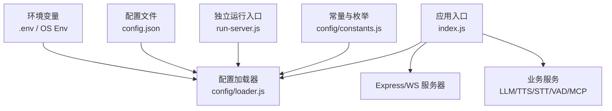
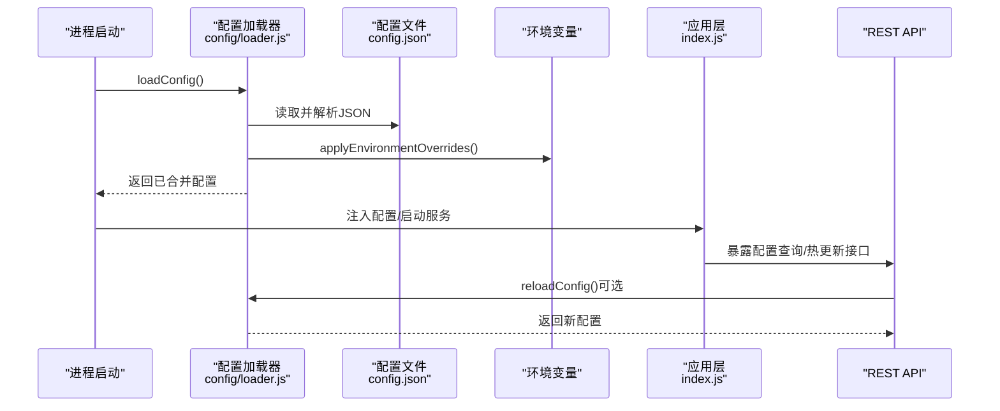
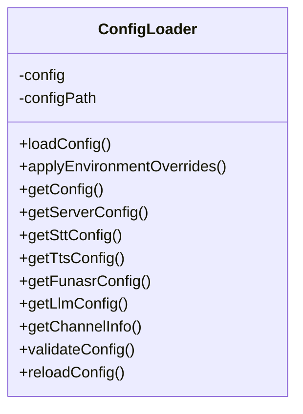
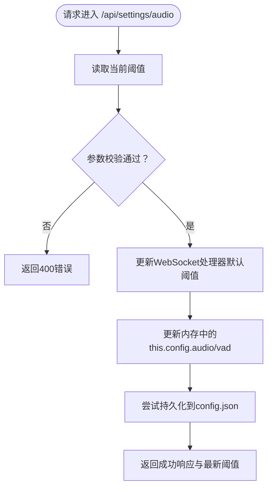
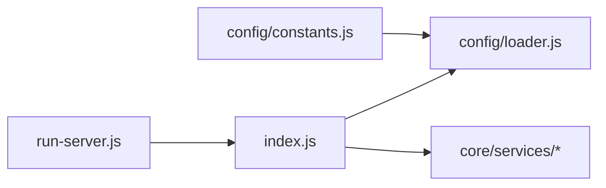

# 配置管理

<cite>
**本文引用的文件**   
- [config/loader.js](file://config/loader.js)
- [config/constants.js](file://config/constants.js)
- [index.js](file://index.js)
- [run-server.js](file://run-server.js)
- [package.json](file://package.json)
</cite>

## 目录
1. [引言](#引言)
2. [项目结构](#项目结构)
3. [核心组件](#核心组件)
4. [架构总览](#架构总览)
5. [详细组件分析](#详细组件分析)
6. [依赖关系分析](#依赖关系分析)
7. [性能与扩展性](#性能与扩展性)
8. [故障排查指南](#故障排查指南)
9. [结论](#结论)
10. [附录：配置项清单与最佳实践](#附录配置项清单与最佳实践)

## 引言
本文件面向“配置管理系统”，系统性说明该项目的配置文件结构、环境变量覆盖机制、运行时配置更新（热重载）实现，以及配置加载器的工作原理、默认值处理与校验规则。同时给出常用配置项说明、示例配置建议、最佳实践，并指导如何新增配置项与验证规则。

## 项目结构
本项目采用“集中式配置加载 + 模块按需读取”的方式组织配置：
- 统一加载器位于 config/loader.js，负责从 config.json 读取配置、应用环境变量覆盖、提供便捷访问方法。
- 常量与枚举在 config/constants.js 中导出，基于加载器动态获取频道与服务配置。
- 应用入口 index.js 通过加载器获取配置，初始化服务、暴露 API，并提供音频阈值等运行时配置的热更新接口。
- 独立运行入口 run-server.js 直接读取 config.json 与环境变量，启动 XiaozhiChannel。
- package.json 定义脚本与依赖，支持 dotenv 加载 .env。

图表来源
- [config/loader.js:13-209](file://config/loader.js#L13-L209)
- [config/constants.js:6-42](file://config/constants.js#L6-L42)
- [index.js:14-24](file://index.js#L14-L24)
- [run-server.js:25-35](file://run-server.js#L25-L35)

章节来源
- [config/loader.js:13-209](file://config/loader.js#L13-L209)
- [config/constants.js:6-42](file://config/constants.js#L6-L42)
- [index.js:14-24](file://index.js#L14-L24)
- [run-server.js:25-35](file://run-server.js#L25-L35)

## 核心组件
- 配置加载器 ConfigLoader：单例模式，负责加载、缓存、合并环境变量、提供便捷 getter、校验与热重载。
- 常量模块 constants：从加载器动态获取频道信息、服务配置，导出全局常量与枚举。
- 应用层 index.js：使用加载器提供的配置初始化服务，暴露管理与配置热更新 API。
- 独立运行入口 run-server.js：直接读取 config.json 与环境变量，创建并启动频道实例。

章节来源
- [config/loader.js:13-209](file://config/loader.js#L13-L209)
- [config/constants.js:6-42](file://config/constants.js#L6-L42)
- [index.js:34-39](file://index.js#L34-L39)
- [run-server.js:25-35](file://run-server.js#L25-L35)

## 架构总览
配置系统整体流程如下：
- 启动时，加载器从 config.json 解析 JSON 配置。
- 随后按优先级应用环境变量覆盖（例如 XIAOZHI_PORT、STT_PROVIDER 等）。
- 应用层通过 getConfig/getServerConfig/getSttConfig/getTtsConfig/getFunasrConfig/getLlmConfig/getChannelInfo 等方法获取配置。
- 部分运行时可调整的配置（如音频阈值）通过 REST API 热更新，并持久化回 config.json。

图表来源
- [config/loader.js:22-44](file://config/loader.js#L22-L44)
- [config/loader.js:49-74](file://config/loader.js#L49-L74)
- [index.js:287-344](file://index.js#L287-L344)

## 详细组件分析

### 配置加载器 ConfigLoader
职责与特性：
- 单例缓存：首次加载后缓存 this.config，避免重复 IO。
- 路径解析：自动定位根目录下的 config.json。
- 环境变量覆盖：对 server、stt、tts、funasr 等关键段进行覆盖。
- 便捷访问：提供 getServerConfig/getSttConfig/getTtsConfig/getFunasrConfig/getLlmConfig/getChannelInfo。
- 校验：validateConfig 检查必填字段与子配置完整性。
- 热重载：reloadConfig 清空缓存并重新加载。

图表来源
- [config/loader.js:13-209](file://config/loader.js#L13-L209)

章节来源
- [config/loader.js:13-209](file://config/loader.js#L13-L209)

### 常量与枚举模块
- 从加载器动态获取频道信息与各项服务配置，导出 CHANNEL_ID、DEFAULT_CONFIG、DEFAULT_SERVICES 及消息类型、状态枚举等。
- 保证常量与运行时配置一致，避免硬编码。

章节来源
- [config/constants.js:6-42](file://config/constants.js#L6-L42)

### 应用层配置使用与热更新
- 启动阶段：index.js 调用 getConfig/getServerConfig 等获取配置，初始化 LLM/TTS/STT/VAD/MCP 等服务。
- 运行时热更新：
  - GET /api/settings/audio：返回当前音频阈值与静默阈值。
  - POST /api/settings/audio：接收 minMaxAmplitude/minAvgAmplitude/silenceThresholdMs，校验范围后：
    - 立即生效：通过 WebSocket 处理器更新默认阈值。
    - 内存更新：写入 this.config.audio/vad。
    - 持久化：写回 config.json。
  - 其他管理 API：设备列表、会话、对话记录、广播等。

图表来源
- [index.js:298-344](file://index.js#L298-L344)

章节来源
- [index.js:287-344](file://index.js#L287-L344)

### 独立运行入口
- 直接读取 config.json，结合环境变量设置 port/host。
- 创建 XiaozhiChannel 并启动，挂载 Studio 路由与静态资源。
- 输出健康检查、OTA、WebSocket 地址等信息。

章节来源
- [run-server.js:25-35](file://run-server.js#L25-L35)
- [run-server.js:37-63](file://run-server.js#L37-L63)

## 依赖关系分析
- 模块耦合：
  - index.js 依赖 config/loader.js 获取配置；依赖 core/services/* 初始化语音链路。
  - config/constants.js 依赖 config/loader.js 获取运行时配置。
  - run-server.js 直接依赖 index.js 的 XiaozhiChannel。
- 外部依赖：
  - express、ws 用于 HTTP/WS 服务。
  - dotenv 用于加载 .env。
  - better-sqlite3 用于持久化（由 store 模块使用）。

图表来源
- [index.js:14-24](file://index.js#L14-L24)
- [config/constants.js:6-13](file://config/constants.js#L6-L13)
- [run-server.js:7-15](file://run-server.js#L7-L15)

章节来源
- [index.js:14-24](file://index.js#L14-L24)
- [config/constants.js:6-13](file://config/constants.js#L6-L13)
- [run-server.js:7-15](file://run-server.js#L7-L15)

## 性能与扩展性
- 配置加载缓存：ConfigLoader 仅首次加载文件，后续直接返回内存对象，减少 IO 开销。
- 热更新局部生效：音频阈值等高频变更项通过内存更新与处理器回调即时生效，无需重启。
- 可扩展点：
  - 新增配置段：在 loader.js 中添加对应的 getter 与 validateConfig 校验逻辑。
  - 新增环境变量覆盖：在 applyEnvironmentOverrides 中追加覆盖规则。
  - 新增运行时热更新：在 index.js 中增加 REST 接口，更新内存并持久化。

[本节为通用指导，不直接分析具体文件]

## 故障排查指南
常见问题与定位要点：
- 配置文件缺失或格式错误：
  - 现象：启动时报错提示找不到配置文件或 JSON 解析失败。
  - 定位：查看加载器的 loadConfig 抛错日志。
  - 参考：[config/loader.js:22-44](file://config/loader.js#L22-L44)
- 端口占用或绑定失败：
  - 现象：启动时报端口不可用。
  - 定位：检查环境变量 XIAOZHI_PORT/PORT 与 config.json 中的 port。
  - 参考：[config/loader.js:53-54](file://config/loader.js#L53-L54)、[run-server.js:31-32](file://run-server.js#L31-L32)
- STT/TTS 未正确初始化：
  - 现象：语音识别/合成失败。
  - 定位：检查 STT_PROVIDER/TTS_PROVIDER 等环境变量与 config.json 对应段。
  - 参考：[config/loader.js:57-66](file://config/loader.js#L57-L66)
- 运行时阈值更新无效：
  - 现象：POST /api/settings/audio 返回成功但行为未变化。
  - 定位：确认是否调用了 WebSocket 处理器的 updateAudioThresholds，并检查校验范围。
  - 参考：[index.js:312-344](file://index.js#L312-L344)

章节来源
- [config/loader.js:22-44](file://config/loader.js#L22-L44)
- [config/loader.js:53-66](file://config/loader.js#L53-L66)
- [index.js:312-344](file://index.js#L312-L344)
- [run-server.js:31-32](file://run-server.js#L31-L32)

## 结论
本项目通过统一的配置加载器集中管理配置，结合环境变量覆盖与运行时热更新，既保证了部署灵活性，又提升了运维效率。建议在生产环境中优先使用环境变量覆盖敏感或易变配置，将稳定配置沉淀于 config.json，并通过 REST API 对少量运行时参数进行热更新。

[本节为总结性内容，不直接分析具体文件]

## 附录：配置项清单与最佳实践

### 配置文件结构与默认值
以下为各配置段的推荐结构与默认值（以加载器与常量模块为准）：
- 顶层基础信息
  - id：频道标识（必填）
  - name：频道名称（必填）
  - desc：频道描述
  - type：频道类型
  - enabled：是否启用
- 服务器
  - port：监听端口（默认 8003）
  - host：监听地址（默认 0.0.0.0）
- STT（语音转文本）
  - provider：提供商（默认 funasr）
  - language：语言（默认 zh-CN）
  - sampleRate：采样率（默认 16000）
  - channels：声道数（默认 1）
  - funasr：
    - host：服务主机（默认 localhost）
    - port：服务端口（默认 10096）
    - is_ssl：是否启用 SSL（默认 false）
    - api_key：API Key（默认 none）
    - mode：工作模式（默认 offline）
    - chunk_size：分块大小数组（默认 [5,10,5]）
    - chunk_interval：分块间隔（默认 10）
    - itn：逆文本标准化（默认 false）
- TTS（文本转语音）
  - provider：提供商（默认 edge）
  - voice：语音（默认 zh-CN-XiaoxiaoNeural）
  - rate：语速（默认 1.0）
  - volume：音量（默认 1.0）
- LLM（大模型）
  - provider：提供商（默认 glm）
  - model：模型名（默认 glm-4-flash）
  - temperature：温度（默认 0.7）
  - maxTokens：最大令牌数（默认 500）

章节来源
- [config/loader.js:98-152](file://config/loader.js#L98-L152)
- [config/constants.js:19-42](file://config/constants.js#L19-L42)

### 环境变量覆盖清单
- 服务器
  - XIAOZHI_PORT / PORT：端口
  - XIAOZHI_HOST / HOST：主机
- STT
  - STT_PROVIDER：提供商
  - STT_LANGUAGE：语言
  - FUNASR_HOST：FunASR 主机
  - FUNASR_PORT：FunASR 端口
  - FUNASR_MODE：FunASR 模式
  - FUNASR_SSL：是否启用 SSL（true/false）
  - FUNASR_API_KEY：FunASR API Key
  - FUNASR_SKIP_STARTUP_CHECK：跳过 FunASR 启动检查（true/false）
- TTS
  - TTS_PROVIDER：提供商
  - TTS_VOICE：语音
- 其他
  - NODE_ENV：运行环境
  - USE_HTTPS：是否使用 WSS（true/false）

章节来源
- [config/loader.js:53-74](file://config/loader.js#L53-L74)
- [index.js:428-442](file://index.js#L428-L442)

### 示例配置（建议）
以下为一个最小可用的 config.json 结构示例（请根据实际部署替换值）：
- 顶层：id、name、desc、type、enabled
- stt：provider=funasr、language=zh-CN、sampleRate=16000、channels=1、funasr.host=localhost、funasr.port=10096、funasr.mode=offline
- tts：provider=edge、voice=zh-CN-XiaoxiaoNeural
- llm：provider=glm、model=glm-4-flash、temperature=0.7、maxTokens=500

注意：
- 若使用 FunASR 本地服务，确保端口可达；如需跳过启动检查，设置 FUNASR_SKIP_STARTUP_CHECK=true。
- 若使用 Edge TTS，确保网络可达且 TTS_PROVIDER=edge。

章节来源
- [config/loader.js:98-152](file://config/loader.js#L98-L152)

### 运行时配置热更新
- 查询音频阈值：GET /api/settings/audio
- 更新音频阈值：POST /api/settings/audio
  - 入参：minMaxAmplitude、minAvgAmplitude、silenceThresholdMs
  - 校验规则：
    - minMaxAmplitude/minAvgAmplitude：整数，范围 0~10000
    - silenceThresholdMs：整数，范围 300~5000
  - 效果：
    - 立即生效：WebSocket 处理器默认阈值更新
    - 内存更新：this.config.audio/vad
    - 持久化：写回 config.json

章节来源
- [index.js:298-344](file://index.js#L298-L344)

### 添加新配置项的步骤
1. 在 config.json 中新增字段（例如 newFeature.enabled）。
2. 在 config/loader.js 中：
   - 在 applyEnvironmentOverrides 中增加环境变量覆盖（例如 NEW_FEATURE_ENABLED）。
   - 在对应 getter（如 getNewFeatureConfig）中提供默认值。
   - 在 validateConfig 中增加必填或取值范围校验。
3. 在 config/constants.js 中导出新的常量（如 DEFAULT_NEW_FEATURE），便于全局使用。
4. 在 index.js 中：
   - 初始化相关服务时使用新配置。
   - 如需运行时热更新，新增 REST 接口，完成校验、内存更新与持久化。

章节来源
- [config/loader.js:49-74](file://config/loader.js#L49-L74)
- [config/loader.js:169-209](file://config/loader.js#L169-L209)
- [config/constants.js:6-42](file://config/constants.js#L6-L42)
- [index.js:287-344](file://index.js#L287-L344)

### 添加新验证规则的建议
- 必填字段：在 validateConfig 中检查是否存在。
- 取值范围：对数值型字段进行边界检查（如 0~10000）。
- 枚举值：对 provider、mode 等字段限制合法取值集合。
- 组合校验：当多个字段相互依赖时，进行联合校验（例如启用某功能时必须提供相应密钥）。

章节来源
- [config/loader.js:169-209](file://config/loader.js#L169-L209)

### 最佳实践
- 敏感配置（如 API Key）优先使用环境变量，不要写入 config.json。
- 将稳定配置（如端口、语言、模型名）放入 config.json，便于版本化管理。
- 对高频变更的参数（如音频阈值）使用运行时热更新接口，避免重启。
- 在 CI/CD 中执行 validateConfig，提前发现配置错误。
- 使用 NODE_ENV 区分开发/测试/生产环境，配合不同环境变量策略。

[本节为通用指导，不直接分析具体文件]