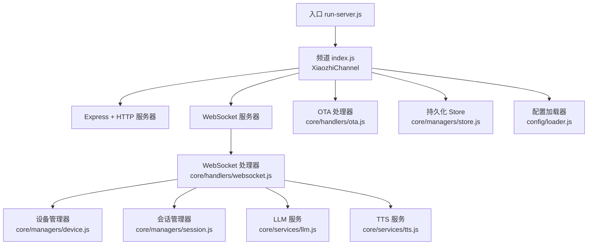
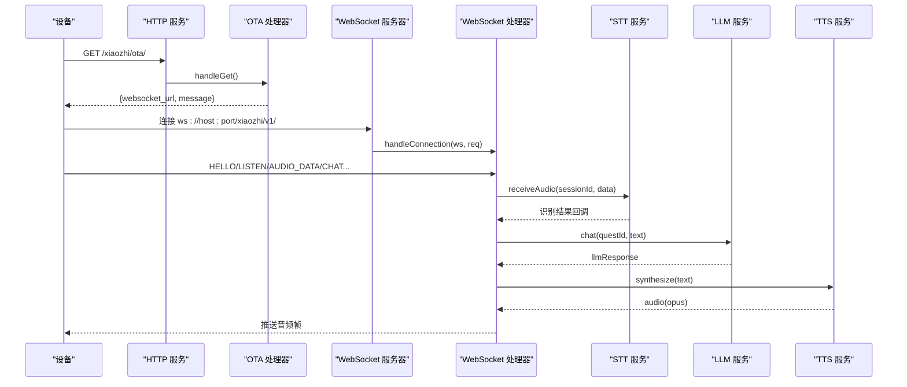
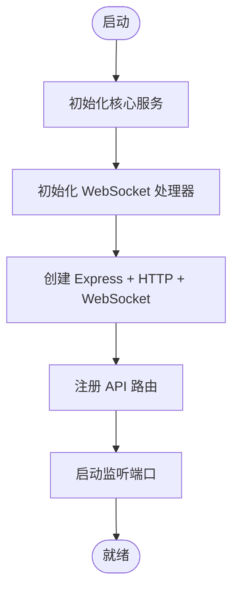
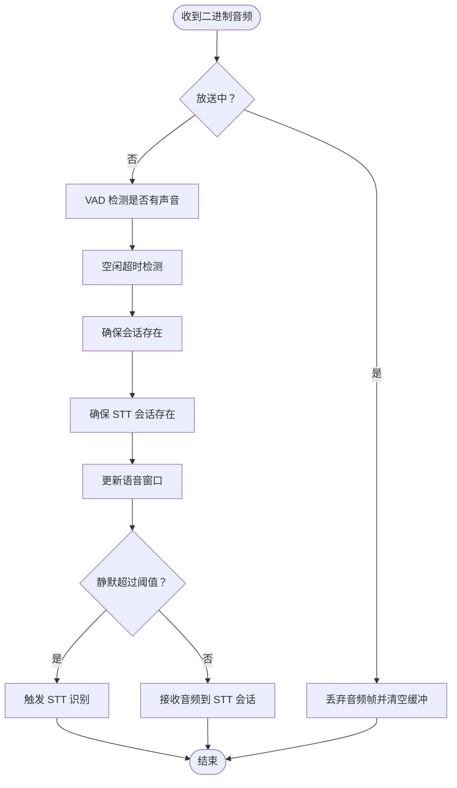
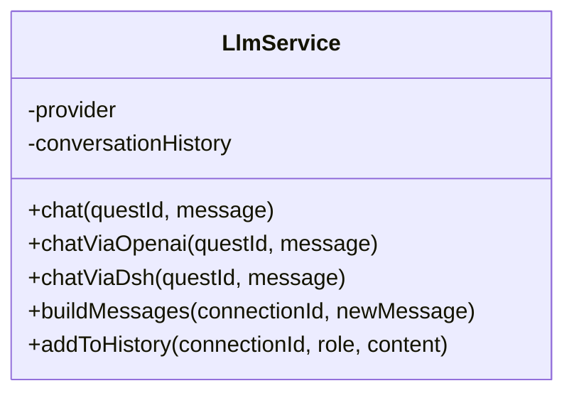
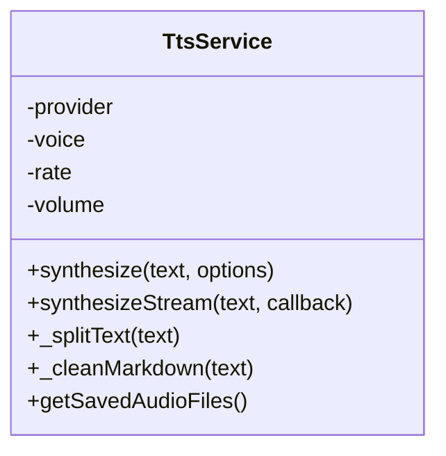
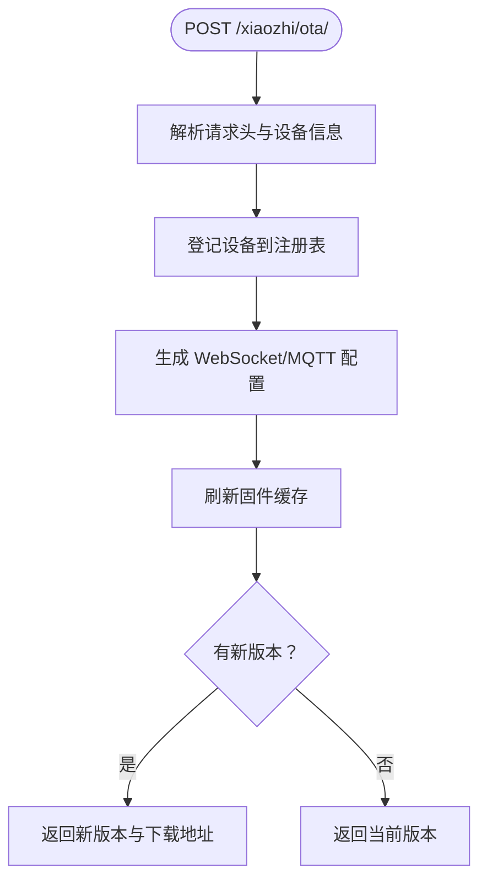
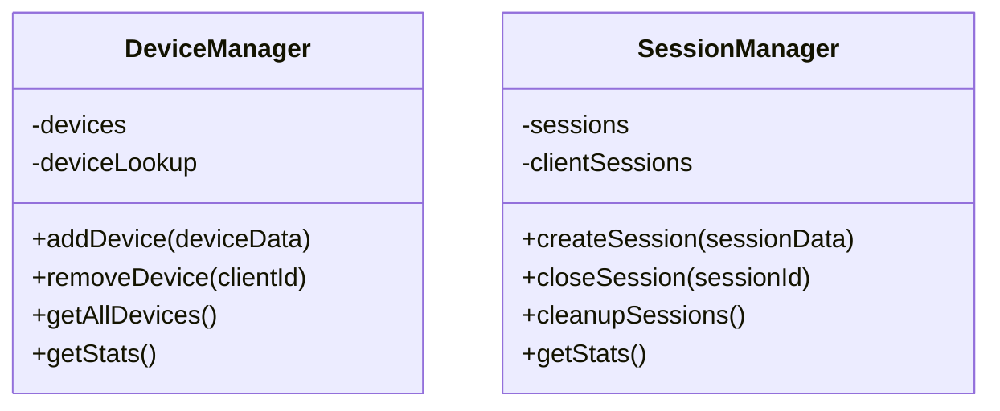
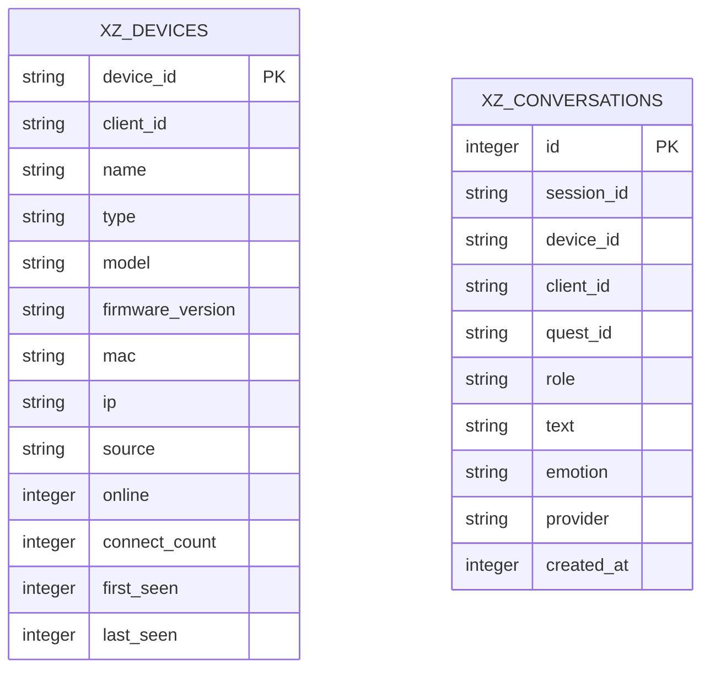
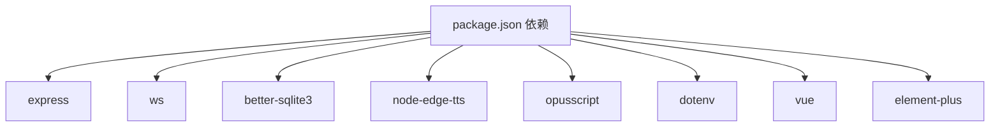

# 项目概述

<cite>
**本文引用的文件**   
- [package.json](file://package.json)
- [index.js](file://index.js)
- [run-server.js](file://run-server.js)
- [core/handlers/websocket.js](file://core/handlers/websocket.js)
- [core/handlers/ota.js](file://core/handlers/ota.js)
- [core/managers/device.js](file://core/managers/device.js)
- [core/managers/session.js](file://core/managers/session.js)
- [core/managers/store.js](file://core/managers/store.js)
- [core/services/llm.js](file://core/services/llm.js)
- [core/services/tts.js](file://core/services/tts.js)
- [config/loader.js](file://config/loader.js)
</cite>

## 目录
1. [引言](#引言)
2. [项目结构](#项目结构)
3. [核心组件](#核心组件)
4. [架构总览](#架构总览)
5. [详细组件分析](#详细组件分析)
6. [依赖关系分析](#依赖关系分析)
7. [性能与可靠性](#性能与可靠性)
8. [快速开始](#快速开始)
9. [常见问题排查](#常见问题排查)
10. [结论](#结论)

## 引言
小智语音交互服务器是一个独立的物联网语音对话解决方案，提供实时语音交互、设备管理、OTA固件升级、会话与设备持久化等能力。它基于 Node.js 与 Express 构建 HTTP 服务，使用 WebSocket 实现低延迟双向通信，并通过可插拔的 LLM、TTS、STT、VAD、声纹与 MCP 服务完成“语音输入→识别→大模型→合成→播放”的完整闭环。项目采用独立运行模式（standalone），不再依赖外部主智能体进程，LLM 通过 OpenAI 兼容端点或 dsh-xiaozhi-bridge 直接调用，便于在局域网或本地环境中快速部署。

该项目适合以下场景：
- 硬件设备（如 ESP32、开发板）接入语音对话
- 网页客户端进行语音测试与调试
- 为 IoT 设备提供统一的 OTA 升级通道
- 将语音交互能力集成到自有业务系统

## 项目结构
仓库采用分层组织方式：
- 配置层：统一从 config.json 加载配置，并支持环境变量覆盖
- 服务层：LLM、TTS、STT、VAD、声纹、MCP 等服务模块
- 管理器层：设备、会话、存储等运行时状态管理
- 处理器层：WebSocket 消息处理与 OTA 协议处理
- 入口层：Express + WebSocket 服务启动与路由挂载
- 前端资源：public/chat 提供 Web 端语音交互页面与 Live2D 资源
- 工作台：studio 提供固件管理工作台（Vue 3 + Element Plus）

**图表来源**
- [run-server.js:25-55](file://run-server.js#L25-L55)
- [index.js:44-125](file://index.js#L44-L125)
- [core/handlers/websocket.js:22-60](file://core/handlers/websocket.js#L22-L60)
- [core/handlers/ota.js:7-16](file://core/handlers/ota.js#L7-L16)
- [core/managers/device.js:4-9](file://core/managers/device.js#L4-L9)
- [core/managers/session.js:4-10](file://core/managers/session.js#L4-L10)
- [core/managers/store.js:29-35](file://core/managers/store.js#L29-L35)
- [config/loader.js:13-17](file://config/loader.js#L13-L17)

**章节来源**
- [package.json:1-29](file://package.json#L1-L29)
- [index.js:1-706](file://index.js#L1-L706)
- [run-server.js:1-75](file://run-server.js#L1-L75)

## 核心组件
- XiaozhiChannel：频道类，负责初始化服务、创建 Express/HTTP/WebSocket、注册 API 路由、启动与停止服务。
- WebSocketHandler：处理连接、心跳、消息分发、音频流、VAD、STT/TTS 流程、轮次串行化与打断控制。
- DeviceManager：在线设备注册表，维护 clientId 与 deviceId 映射，统计在线/离线设备。
- SessionManager：会话生命周期管理，包含创建、查询、关闭、清理过期会话。
- LlmService：LLM 调用封装，支持 openai 直连与 dsh 桥接，具备降级回复与历史上下文。
- TtsService：文本转语音，默认 Edge TTS，支持多提供商扩展、流式合成与音频文件保存。
- OTAHandler：设备 OTA 升级接口，返回 WebSocket/MQTT 配置，扫描 bin 目录下发固件版本与下载地址。
- XiaozhiStore：SQLite 持久化，记录设备注册信息与对话历史，写入失败不阻塞主流程。
- ConfigLoader：统一配置加载与环境变量覆盖。

**章节来源**
- [index.js:44-125](file://index.js#L44-L125)
- [core/handlers/websocket.js:22-60](file://core/handlers/websocket.js#L22-L60)
- [core/managers/device.js:4-9](file://core/managers/device.js#L4-L9)
- [core/managers/session.js:4-10](file://core/managers/session.js#L4-L10)
- [core/services/llm.js:16-24](file://core/services/llm.js#L16-L24)
- [core/services/tts.js:3-21](file://core/services/tts.js#L3-L21)
- [core/handlers/ota.js:7-16](file://core/handlers/ota.js#L7-L16)
- [core/managers/store.js:29-35](file://core/managers/store.js#L29-L35)
- [config/loader.js:13-17](file://config/loader.js#L13-L17)

## 架构总览
整体架构围绕“设备→WebSocket→服务端处理器→语音服务→设备”的闭环展开。设备通过 HTTP 获取 OTA 信息，随后建立 WebSocket 连接；服务端根据消息类型分发到 STT、LLM、TTS 等子服务，最终将音频流回推至设备。

**图表来源**
- [core/handlers/ota.js:316-333](file://core/handlers/ota.js#L316-L333)
- [core/handlers/websocket.js:67-169](file://core/handlers/websocket.js#L67-L169)
- [core/handlers/websocket.js:228-283](file://core/handlers/websocket.js#L228-L283)
- [core/handlers/websocket.js:651-694](file://core/handlers/websocket.js#L651-L694)
- [core/services/llm.js:75-104](file://core/services/llm.js#L75-L104)
- [core/services/tts.js:62-104](file://core/services/tts.js#L62-L104)

## 详细组件分析

### 频道与服务启动（XiaozhiChannel）
XiaozhiChannel 是服务入口的核心类，负责：
- 初始化设备、会话、OTA、Store 与各语音服务
- 设置 Express 中间件与静态资源
- 注册健康检查、设备管理、广播、WebSocket URL、OTA 等 API
- 启动 HTTP/WebSocket 服务并输出连接信息

关键职责与行为：
- start()：按顺序初始化服务、WebSocket 处理器、Express 服务器、启动监听端口
- setupRoutes()：暴露 /health、/api/devices、/api/conversations、/api/broadcast、/xiaozhi/ota/* 等接口
- initializeWebSocketHandler()：注入所有服务到 WebSocket 处理器
- stop()/cleanupServices()：优雅关闭服务并释放资源

**图表来源**
- [index.js:86-125](file://index.js#L86-L125)
- [index.js:254-282](file://index.js#L254-L282)
- [index.js:287-488](file://index.js#L287-L488)
- [index.js:493-511](file://index.js#L493-L511)

**章节来源**
- [index.js:44-125](file://index.js#L44-L125)
- [index.js:254-511](file://index.js#L254-L511)

### WebSocket 消息处理与语音对话流程
WebSocketHandler 承担连接管理与消息分发，核心逻辑包括：
- 连接建立：解析 client-id、device-id、client_type，登记设备，发送握手确认
- 消息路由：HELLO/LISTEN/ABORT/IOT/CHAT/MCP/AUDIO_DATA/WAKE_WORD_DETECTED 等
- 音频处理：二进制数据进入 VAD 检测、静默阈值判断、STT 会话缓冲与触发识别
- 对话轮次：串行化处理单轮对话，避免 Opus 帧交错，支持用户打断与回声过滤
- 会话与设备：自动创建会话，维护 sessionId、turnSeq、abortUpTo 等状态

**图表来源**
- [core/handlers/websocket.js:289-446](file://core/handlers/websocket.js#L289-L446)

**章节来源**
- [core/handlers/websocket.js:67-169](file://core/handlers/websocket.js#L67-L169)
- [core/handlers/websocket.js:228-283](file://core/handlers/websocket.js#L228-L283)
- [core/handlers/websocket.js:289-446](file://core/handlers/websocket.js#L289-L446)
- [core/handlers/websocket.js:651-694](file://core/handlers/websocket.js#L651-L694)

### LLM 服务（openai/dsh 双路径）
LlmService 在 standalone 模式下仅支持两种 provider：
- openai：直连 OpenAI 兼容端点（如 aibridge），读取 apiKey 或环境变量
- dsh：经 dsh-xiaozhi-bridge 调用 DeepSeek Harness agent，失败时回退 openai 或降级回复

特性：
- 构建消息列表（system + 最近 N 轮 + 新消息）
- 保持每连接的历史上下文
- 健康检查与降级策略

**图表来源**
- [core/services/llm.js:16-24](file://core/services/llm.js#L16-L24)
- [core/services/llm.js:75-104](file://core/services/llm.js#L75-L104)
- [core/services/llm.js:121-160](file://core/services/llm.js#L121-L160)
- [core/services/llm.js:166-203](file://core/services/llm.js#L166-L203)
- [core/services/llm.js:211-252](file://core/services/llm.js#L211-L252)

**章节来源**
- [core/services/llm.js:16-24](file://core/services/llm.js#L16-L24)
- [core/services/llm.js:75-104](file://core/services/llm.js#L75-L104)
- [core/services/llm.js:121-203](file://core/services/llm.js#L121-L203)
- [core/services/llm.js:211-252](file://core/services/llm.js#L211-L252)

### TTS 服务（Edge 默认）
TtsService 默认使用 Edge TTS，支持：
- 文本清理与分段合成
- 多种提供商扩展（xunfei、aliyun）
- 音频时长估算与文件保存
- 流式合成回调

**图表来源**
- [core/services/tts.js:3-21](file://core/services/tts.js#L3-L21)
- [core/services/tts.js:62-104](file://core/services/tts.js#L62-L104)
- [core/services/tts.js:209-267](file://core/services/tts.js#L209-L267)
- [core/services/tts.js:274-286](file://core/services/tts.js#L274-L286)

**章节来源**
- [core/services/tts.js:3-21](file://core/services/tts.js#L3-L21)
- [core/services/tts.js:62-104](file://core/services/tts.js#L62-L104)
- [core/services/tts.js:209-286](file://core/services/tts.js#L209-L286)

### OTA 处理器（设备升级）
OTAHandler 提供：
- 设备上报登记（deviceId/model/version/mac/ip/source）
- 返回 WebSocket/MQTT 配置
- 扫描 data/bin 目录，按型号与版本号下发最新固件
- 安全校验与下载接口

**图表来源**
- [core/handlers/ota.js:162-311](file://core/handlers/ota.js#L162-L311)
- [core/handlers/ota.js:358-391](file://core/handlers/ota.js#L358-L391)

**章节来源**
- [core/handlers/ota.js:7-16](file://core/handlers/ota.js#L7-L16)
- [core/handlers/ota.js:162-311](file://core/handlers/ota.js#L162-L311)
- [core/handlers/ota.js:358-391](file://core/handlers/ota.js#L358-L391)

### 设备与会话管理
- DeviceManager：维护 Map(clientId → DeviceModel)，支持添加、更新、移除、搜索与统计
- SessionManager：维护 Map(sessionId → SessionModel)，支持创建、查询、关闭、清理过期会话

**图表来源**
- [core/managers/device.js:4-9](file://core/managers/device.js#L4-L9)
- [core/managers/device.js:12-41](file://core/managers/device.js#L12-L41)
- [core/managers/device.js:118-136](file://core/managers/device.js#L118-L136)
- [core/managers/session.js:4-10](file://core/managers/session.js#L4-L10)
- [core/managers/session.js:12-45](file://core/managers/session.js#L12-L45)
- [core/managers/session.js:117-138](file://core/managers/session.js#L117-L138)

**章节来源**
- [core/managers/device.js:4-41](file://core/managers/device.js#L4-L41)
- [core/managers/device.js:118-136](file://core/managers/device.js#L118-L136)
- [core/managers/session.js:4-45](file://core/managers/session.js#L4-L45)
- [core/managers/session.js:117-138](file://core/managers/session.js#L117-L138)

### 持久化 Store（设备与对话）
XiaozhiStore 使用 SQLite 持久化：
- xz_devices：设备注册表（含离线设备）
- xz_conversations：对话记录（user/bot 各一条）
- 写操作失败降级为 no-op，不影响语音主流程

**图表来源**
- [core/managers/store.js:44-75](file://core/managers/store.js#L44-L75)

**章节来源**
- [core/managers/store.js:29-83](file://core/managers/store.js#L29-L83)
- [core/managers/store.js:85-150](file://core/managers/store.js#L85-L150)
- [core/managers/store.js:152-202](file://core/managers/store.js#L152-L202)
- [core/managers/store.js:204-233](file://core/managers/store.js#L204-L233)

### 配置加载器
ConfigLoader 从 config.json 加载配置，并应用环境变量覆盖：
- 服务器端口/主机
- STT/TTS/FunASR/LLM 配置
- 频道基本信息

**章节来源**
- [config/loader.js:13-17](file://config/loader.js#L13-L17)
- [config/loader.js:49-74](file://config/loader.js#L49-L74)
- [config/loader.js:89-152](file://config/loader.js#L89-L152)
- [config/loader.js:157-166](file://config/loader.js#L157-L166)

## 依赖关系分析
项目依赖的关键库与用途：
- express：HTTP 服务与路由
- ws：WebSocket 服务器
- better-sqlite3：SQLite 持久化
- node-edge-tts：Edge TTS 合成
- opusscript：Opus 编解码
- dotenv：环境变量加载
- element-plus/vue：固件工作台 UI

**图表来源**
- [package.json:11-22](file://package.json#L11-L22)

**章节来源**
- [package.json:1-29](file://package.json#L1-L29)

## 性能与可靠性
- 轮次串行化与超时保护：同一连接同一时刻只有一条应答流程，防止 Opus 帧交错；单轮超时释放队列，避免后续轮次永久排队
- 回声与噪音过滤：对无 AEC 设备的回声拾取进行相似度判定并忽略；无效输入（过短/语气词）在进入对话前被过滤
- VAD 静默阈值与最长语音兜底：结合静默时间与连续语音上限，避免无限“倾听中”
- 广播期间静音麦克风：语音放送播放中暂停麦克风输入，减少回声干扰
- 持久化降级：Store 写入失败不阻塞主流程，保证语音对话稳定性

[本节为通用性能讨论，不直接分析具体文件]

## 快速开始
- 安装依赖：npm install
- 启动服务：npm start 或 node run-server.js
- 访问地址：
  - HTTP：http://localhost:<PORT>
  - OTA：http://<LAN_IP>:<PORT>/xiaozhi/ota/
  - WebSocket：ws://<LAN_IP>:<PORT>/xiaozhi/v1/
  - 健康检查：http://localhost:<PORT>/health
  - 工作台：http://localhost:<PORT>/firmware/

常用 API：
- GET /health：服务健康状态
- GET /api/devices：当前在线设备
- GET /api/devices/known：已知设备列表（含离线）
- GET /api/devices/stats：设备与对话统计
- GET /api/conversations：对话记录查询
- POST /api/broadcast：语音放送（向在线设备推送文本）
- GET /api/websocket/urls：WebSocket 连接信息
- GET/POST /xiaozhi/ota/：设备 OTA 升级接口

环境配置要点：
- 端口与主机：XIAOZHI_PORT、XIAOZHI_HOST 或 PORT、HOST
- LLM provider：openai 或 dsh；openai 需设置 apiKey 或环境变量 AIBRIDGE_API_KEY
- TTS provider：edge（默认），voice 可选 zh-CN-XiaoxiaoNeural 等
- STT provider：funasr（默认），语言 zh-CN

**章节来源**
- [run-server.js:25-63](file://run-server.js#L25-L63)
- [index.js:287-488](file://index.js#L287-L488)
- [config/loader.js:49-74](file://config/loader.js#L49-L74)
- [core/services/llm.js:16-24](file://core/services/llm.js#L16-L24)
- [core/services/tts.js:3-21](file://core/services/tts.js#L3-L21)

## 常见问题排查
- 无法连接 WebSocket：
  - 检查 /api/websocket/urls 返回的 ws/wss 地址是否正确
  - 确认防火墙与端口开放
- 设备未出现在 /api/devices：
  - 确认设备已正确发起 HELLO 并携带 device-id
  - 查看日志中的设备注册与断开事件
- LLM 无响应：
  - 检查 provider 与 baseUrl/apiKey 配置
  - 观察 LLM 健康检查与降级回复日志
- TTS 合成失败：
  - 确认 Edge TTS 可用与网络连通
  - 检查输出目录权限与磁盘空间
- OTA 升级失败：
  - 确认 data/bin 目录下存在符合命名规则的 .bin 文件
  - 检查 /xiaozhi/ota/download/:filename 的安全校验与路径限制

**章节来源**
- [core/handlers/websocket.js:67-169](file://core/handlers/websocket.js#L67-L169)
- [core/services/llm.js:30-65](file://core/services/llm.js#L30-L65)
- [core/services/tts.js:23-50](file://core/services/tts.js#L23-L50)
- [core/handlers/ota.js:358-391](file://core/handlers/ota.js#L358-L391)

## 结论
小智语音交互服务器以模块化、可扩展的设计提供了完整的物联网语音对话能力。通过 Express + WebSocket 的低延迟通信、可插拔的 LLM/TTS/STT/VAD 服务、完善的设备管理与 OTA 升级机制，以及 SQLite 持久化保障，项目能够在本地或局域网环境中快速部署并稳定运行。对于新用户，建议从快速开始入手，逐步熟悉设备接入、语音对话与 OTA 升级流程，并根据业务需求调整 LLM/TTS/STT 配置与参数。

[本节为总结性内容，不直接分析具体文件]